# RF1 SRA environment — Social Doors

This repository contains the reproducible participant-generation, environmental
linkage, Level 3 input-building, and group-analysis code for the Social Doors
component of the RF1 brain-health/environment project.

The workflow deliberately separates private participant information from files
that may be published. The participant-generation stages run on the authorized
Windows machine with access to private data. Their cleaned output is committed
here and can then be cloned to the Linux analysis machine for Level 3 modeling.

## Workflow

```mermaid
flowchart LR
    A[Private screener and imaging roster] --> B[01 Create SD cohort]
    B --> C[Private address and ZIP workbook]
    C --> D[02 Link 2024 ADI]
    D --> E[Private ADI and coordinate workbook]
    E --> F[03 Extract 2013–2023 PM2.5]
    F --> G[Public-safe seven-column workbook]
    G --> H[GitHub repository]
    H --> I[Linux clone]
    I --> J[Build exact L3 inputs and covariates]
    J --> K[Paired Social/Monetary Doors group analyses]
```



## Privacy model

The repository must never contain raw screener records, DOB, street address,
ZIP/ZIP9, returned geocodes, latitude/longitude, GISJOIN, or participant-level
linkage and coordinate audits. Those values are read from and written to the
separate Windows-only private tree:

`D:/Postdoc/Paper_brainhealth_environment/private data`

The only participant-level analysis workbook published here is
`data/derived/SD_analysis_data_2026-10-26.xlsx`. It contains one `Data` sheet
and exactly these approved fields:

| Field | Description |
| --- | --- |
| `rf1_id` | Pseudonymous RF1/BIDS participant identifier |
| `sub_age` | Completed age at the screener date |
| `gender` | Source gender code or label used by the L3 builder |
| `ecog_score` | ECog total score |
| `mspss_sum` | MSPSS total score |
| `adi_natrank` | 2024 Neighborhood Atlas national ADI rank |
| `pm25_mean_2013_2023` | Mean of the 11 annual PM2.5 values, in µg/m³ |

The final R stage enforces this allowlist before writing into the repository.
The `.gitignore` rules provide an additional guard against common raw and
linkage filenames, but they are not a substitute for reviewing every commit.

## Repository layout

```text
code/
  01_create_sd_analysis_file.R   private cohort construction
  02_link_sd_adi.R               private ADI linkage
  03_extract_sd_pm25.R           private PM2.5 extraction and public export
  build_L3_inputs.sh             Linux L3 input orchestrator
  build_L3_covariates.py         validation and centered-covariate builder
  project_config.sh              Linux upstream-data configuration
  L3stats.sh                     paired randomise analyses
  run_L3stats.sh                 L3 analysis entry point
data/derived/
  SD_analysis_data_2026-10-26.xlsx
  SD_pipeline_summary_2026-10-26.csv
  l3/                             generated on Linux
templates/
  L3_task-socialdoors_model-3_type-act_group-brainhealth-environment_randomise.fsf
```

## Scientific cohort definition

This release is intentionally fixed to:

- screener export `IslandScreener-JacobSophieKatieData_DATA_2026-10-26_1247.csv`;
- the validated 137-participant Social Doors imaging roster from October 26,
  2026;
- 2024 Neighborhood Atlas ADI version 4.0.1; and
- annual ACAG V5.NA.05 Hybrid PM2.5 rasters for 2013–2023.

The pipeline canonicalizes an `rf1_id` ending in `_duplicate` to its numeric ID,
intersects the screener with the validated imaging roster, requires complete age,
ECog, MSPSS, address, ZIP, and gender fields, and deterministically resolves
eligible duplicate screener rows. ADI linkage proceeds through ZIP9, rooftop
point-in-polygon linkage, and the fixed reviewed re-geocoding audit. Participants
must have numeric ADI ranks and all 11 annual PM2.5 values. The PM2.5 mean is
rounded to four decimal places.

The validated public result contains 110 participants. A different count is a
reason to stop and investigate rather than silently continue.

## Part 1: run the private participant pipeline on Windows

### Requirements

- R 4.5 or a compatible recent R release;
- R packages `readxl`, `writexl`, and `sf`;
- the private inputs and reference products listed below; and
- enough local storage for the ADI crosswalks and annual PM2.5 rasters.

Install missing R packages from an R console:

```r
install.packages(c("readxl", "writexl", "sf"))
```

### Required private-data layout

```text
private data/
  raw/
    IslandScreener-JacobSophieKatieData_DATA_2026-10-26_1247.csv
  inputs/
    subjects_socialdoors_2026-10-26.txt
    geocodio_download_118_cohort_2026-10-26.csv
    adi_regeocode_review_2026-10-16.csv
  reference/
    adi-download/
      adi-download_Pennsylvania/PA_2024_ADI_9Digit_Zip_v4_0_1.csv
      adi-download_NewJersey/NJ_2024_ADI_9Digit_Zip_v4_0_1.csv
      adi-download_Delaware/DE_2024_ADI_9Digit_Zip_v4_0_1.csv
      adi-download_Maryland/MD_2024_ADI_9Digit_Zip_v4_0_1.csv
      adi-download_Virginia/VA_2024_ADI_9Digit_Zip_v4_0_1.csv
      tigerline_2024_bg/
    pm-download/Annual/Annual/
      V5NA05.HybridPM25.xNorthAmerica.<year>001-<year><last-day>.asc.zip
  intermediate/
    SD_2026-10-26/               created by the pipeline
```

The private files are not distributed with this repository. An authorized user
must obtain them through the project’s approved data-transfer process. If the
private tree is stored elsewhere, update the `private_root` constant near the
top of each numbered R script before running it.

### Run the three stages

From the repository root in PowerShell:

```powershell
& "C:\Program Files\R\R-4.5.2\bin\Rscript.exe" .\code\01_create_sd_analysis_file.R
& "C:\Program Files\R\R-4.5.2\bin\Rscript.exe" .\code\02_link_sd_adi.R
& "C:\Program Files\R\R-4.5.2\bin\Rscript.exe" .\code\03_extract_sd_pm25.R
```

Stage 1 writes the address-bearing cohort and exclusion audit only under
`private data/intermediate/SD_2026-10-26`. Stage 2 adds private ADI linkage and
the coordinates used for exposure extraction. Stage 3 writes the detailed
coordinate and annual-exposure audit privately, then writes only the approved
seven-column workbook and aggregate summary under `data/derived`.

Before committing regenerated outputs, confirm that the workbook has 110 rows
and the exact seven-column schema above.

## Part 2: build L3 inputs on Linux

The Linux builder does not need the Windows private-data tree. It starts from
the cleaned workbook committed in `data/derived`, but it does require access to
the separately maintained preprocessing handoff and imaging files.

### Requirements

- Bash and standard GNU command-line tools (`awk`, `grep`, `paste`, `sort`,
  `wc`, and `mktemp`);
- Python 3 with `openpyxl`;
- the validated preprocessing handoff;
- readable cope, varcope, mask, and DOF files referenced by that handoff; and
- BIDS JSON sidecars containing `SoftwareVersions` for selected runs.

Install the Python dependency if necessary:

```bash
python3 -m pip install openpyxl
```

### Default upstream paths

`code/project_config.sh` defaults to:

```text
/ZPOOL/data/projects/rf1-sra-linux2/
  bids/
  work/coverage95-handoff-20261021-204525/
    run_decisions.tsv
    socialdoors/selected_inputs.tsv
    doors/selected_inputs.tsv
```

The Social Doors selected-input table must contain one validated session-01,
run-1, L1 row for each of four contrasts per participant. The builder also
checks that every retained participant has the validated Monetary Doors cope-4
input used by the paired analyses.

If the upstream data live elsewhere, set one or more overrides before running:

```bash
export RF1_SRA_UPSTREAM_ROOT=/path/to/rf1-sra-linux2
export RF1_SRA_HANDOFF_ROOT=/path/to/coverage95-handoff-20261021-204525
export BIDS_ROOT=/path/to/bids
export SELECTED_INPUTS=/path/to/socialdoors/selected_inputs.tsv
export RUN_DECISIONS=/path/to/run_decisions.tsv
# Optional replacement for the committed cleaned workbook:
export ANALYSIS_FILE=/path/to/SD_analysis_data_2026-10-26.xlsx
```

### Run the builder

```bash
git clone https://github.com/DVS-Lab/rf1-sra-environment-SD.git
cd rf1-sra-environment-SD
python3 -c "import openpyxl"
bash code/build_L3_inputs.sh
```

The builder fails rather than silently excluding a participant when exact
handoff files, run metrics, BIDS metadata, or required covariates are missing.
It writes the following aligned outputs to `data/derived/l3`:

- `L3-act-subjects.txt`: final participants in handoff order;
- `L3-act-input-paths.txt`: generic `TASK`/`COPENUM` path per participant;
- `L3-act-selected-inputs.tsv`: exact retained handoff rows;
- `L3-act-contrast-inputs/contrast-01.tsv` through `contrast-04.tsv`;
- `L3-act-final-qc.csv`: tSNR, mean FD, coverage, and selection metadata;
- `L3-act-covariates.xlsx`: subject-aligned centered covariates; and
- `L3-act-exclusions.tsv`: linked-cohort participants not selected at L3.

The covariate workbook includes centered ECog, national ADI rank, MSPSS,
2013–2023 mean PM2.5, age, tSNR, and mean FD; centered gender indicators; and
centered scanner-software indicators when more than one software version is
present.

## Part 3: run the Social/Monetary Doors L3 analyses

This repository includes the FSL template for the two prespecified paired
randomise analyses: Social minus Monetary and their mean, both using cope 4.
After reviewing the generated subject, path, and covariate files, run:

```bash
bash code/run_L3stats.sh
```

The current paired template is an intercept-only group design. It uses the
generated subject list and generic input-path file but does not directly consume
`L3-act-covariates.xlsx`. That workbook is produced as a checked, subject-aligned
handoff for covariate models and should not be assumed to enter this particular
randomise design unless the template and runner are explicitly revised.

This stage requires FSL commands including `fslmaths`, `fslmerge`,
`feat_model`, and `randomise`. Imaging outputs are written below
`derivatives/fsl/randomise` and are excluded from Git.

## Validation and troubleshooting

- **Unexpected participant count:** stop if the public workbook is not 110 rows.
- **Missing private input:** check the fixed private-data filenames and
  `private_root` in all three R scripts.
- **Geocodio mismatch:** the saved Geocodio return must contain every current
  cohort address + ZIP5 exactly once.
- **TIGER file missing:** stage 2 uses the local cache and may download a missing
  2024 state block-group archive from the Census Bureau.
- **Builder reports an unreadable image:** this is an access or preprocessing
  error, not a scientific participant exclusion.
- **`SoftwareVersions` error:** confirm that the selected BIDS echo-2 JSON
  sidecars exist and agree across selected runs.
- **Different upstream handoff:** use explicit environment overrides and record
  the alternate handoff version with the analysis results.

Before publishing changes, review the exact commit set:

```bash
git status --short
git add -n -A
```

No raw or private intermediate file should appear in that list.

## License

See `LICENSE` for the repository license. Access to private participant data and
large third-party reference products is governed separately and is not granted
by the repository license.
