# RF1 SRA environment — Social Doors

This repository contains the reproducible participant-generation, environmental
linkage, Level 3 input-building, and group-analysis code for the Social Doors
component of the RF1 brain-health/environment project.

## Current Analysis Status: N=97 Computation And Final Summary Verified

**Evidence-layout revision:** [matched brain/scatter panels, task-mean contrasts and actual designs](docs/katie-evidence.md).
Existing win-loss and double-subtraction group tests are reused; only the missing
social-win-minus-nonsocial-win intercept needs two new jobs. This supplies the
context/content/conclusion revision without changing the cohort or exclusions.

**Matched neural sensitivity checks:** [FEVS activation and VS connectivity with additive ADI/Ecog adjustments](docs/fevs-imaging-adjustments.md).
All 18 jobs and 48 baseline/adjusted directional FEVS maps validated and
[published successfully](results/review/fevs-imaging-adjustments-provisional-v1/README.md).
N=97, baseline images/masks/design columns, completed results and provisional
scoring are unchanged. These checks test FEVS main effects, not new interactions.

**Requested behavioral sensitivity checks:** [FEVS PM2.5/support models with added ADI, Ecog or both](results/review/fevs-behavioral-adjustments-provisional-v1/README.md)
retain N=97 and report all three requested additive adjustments. These checks
remain provisional while scoring is reviewed and do not rerun or establish
robustness of the neural models.

**Updated shareable preliminary brief:** [FEVS adjusted behavioral and neural results (PDF)](output/pdf/FEVS_Adjusted_Results_2026-11-04.pdf)
includes the ADI/Ecog sensitivity checks, original/adjusted maps, the activation
anatomy/statistical caveat, and an integrated account of PM2.5, support, ADI,
Ecog and secondary OAFEM. Scoring remains provisional; contextual and neural
associations are not a demonstrated pathway. This focused brief does not replace
the complete model inventory, null results or provenance. The
[November 3 brief](output/pdf/FEVS_Main_Results_2026-11-03.pdf) is preserved.

**New behavioral moderation family:** the [behavioral runbook](docs/behavioral-moderation.md)
fits the eight approved age/gender-adjusted FEVS/OAFEM models separately from
the completed neural analyses. FEVS/support interactions lead; Ecog and OAFEM
are secondary. The user authorized provisional use of complete exported totals
while item-scoring documentation and MSPSS zero coding are checked afterward.
The explicit provisional flag is recorded in every report; no cohort changes,
three-way interactions or additional neural jobs are introduced.

**Illustrated synthesis:** the [full final results summary](results/review/final-summary-v1/README.md)
brings together the final map inventory, task-signal checks, FEVS activation and
VS-connectivity findings, environmental/cognitive interactions, correlations,
influence caveats and the remaining targeted figure work. It links existing
validated figures and a compact aggregate table of all 69 corrected maps; no
native statistical images or participant-level diagnostics are added.

The [final computation record](docs/final-computation.md) confirms **220/220
extension jobs completed**, with command/check exits 0 and all **1,328 scientific
directional maps** validated, including retained analyses. The cohort, settled
exclusions, no-TEDANA sm-5 inputs and VS seed are unchanged. No inference rerun
is needed. The final read-only extraction also passed. The seven corrected
Social Doors win minus Doors win VS-connectivity maps concern OAFEM or Ecog
main effects in adjusted models, not FEVS or interaction effects. See the
completion record for their exact model/term breakdown. New cluster anatomy
and influence plots remain a reporting follow-up, not a computation blocker.

**FEVS VS-connectivity figures:** the [read-only VS review launcher](docs/fevs-vs-review.md)
maps the negative FEVS main effect at mean PM2.5 for domain-by-valence VS PPI,
with descriptive scatter/influence plots and automatic Git publication. This
is separate from win-only activation and preserves running jobs and exclusions.

**FEVS loss moderation and Ecog figures:** the [read-only follow-up launcher](docs/reward-followup-review.md)
maps the loss-specific FEVS x PM2.5 interaction and two new Ecog main effects,
with descriptive JN/scatter and influence plots. The small validated report and
progress logs publish automatically without touching running inference or exclusions.

**Targeted FEVS brain/scatter review:** the [read-only reporting launcher](docs/fevs-win-review.md)
refreshes live progress and maps the two completed FEVS win-specific activation
main effects. It preserves running inference and publishes only a small aggregate
report, with all 97 participants retained in the descriptive scatterplots.

**Complete reward-component extension:** the [60-worker launcher](docs/reward-extension.md)
adds wins/losses for all previous activation and VS-connectivity models, explicitly
tests main effects/interactions, and fills missing older main-effect tests while
preserving every compatible completed result and the same 97 participants.

**PM2.5 additive component follow-up:** the [six-job component runner](docs/pm25-components.md)
compares social-minus-nonsocial wins, losses and their valence difference with
the same PM2.5 + Ecog adjustment model, preserving N=97 and all completed analyses.

**Launch the remaining task activation, conditional effects and VS PPI:** use
the [single 48-worker Linux2 launcher](docs/run-all-remaining.md). It preserves
the completed original batch, averages task effects/covariates within person,
and reuses only connectivity inputs with verified matching no-TEDANA lineage.
Any needed PPI rebuilds are isolated, with no new exclusions or production reruns.

**Financial-score previews:** Jacob's [FEVS/OAFEM file](data/derived/FEVS_OAFEM_scores_katie-cohort-v1.csv)
has complete numeric data for all 97 frozen participants. Separate predictor
[model previews](data/derived/financial-model-review-v1/README.md) are prepared,
with FEVS leading this supplemental analysis and OAFEM secondary. No new jobs
were launched during preview generation. The [isolated financial-model launcher](docs/run-financial-models.md)
now supports the user-requested separate-score activation and VS-PPI analyses,
without pulling over active code or interrupting the existing jobs. No
interactions or new exclusions are introduced.

**Financial-score moderation:** the separate [two-way moderation launcher](docs/run-financial-moderation.md)
tests FEVS (lead) and OAFEM (secondary) interactions with MSPSS, ADI, PM2.5 and
Ecog, one moderator per model, with both main effects included. It preserves
N=97 and all existing jobs/results, can safely share inputs with the predictor
batch using `moderation-concurrent`, and adds no three-way interactions or exclusions. Its three-line launcher also provides
a read-only status mode for diagnosing interrupted terminal pastes.

For a live progress check and a peek at verified completed financial results,
use the [read-only snapshot](docs/financial-progress.md). It reports both batches,
all completed directions including nulls, process activity and possible stale
markers, without interrupting or restarting analyses. Its run record publishes
through Git automatically.

For the complete activation/connectivity audit, brain panels, scatterplots and
descriptive Johnson-Neyman follow-ups, use the [full results-review launcher](docs/full-results-review.md).
This earlier review covers 152 completed jobs / 336 directional maps, not the
final 1,328-map catalog. It preserves the frozen
cohort and inference, and publishes validated aggregate figures to GitHub.

The published [Linux2 completion record](https://github.com/DVS-Lab/rf1-sra-linux2/blob/main/logs/records/20261101-232106_katie-overnight-20261101-231810-randomise.md)
confirms all **24 jobs / 48 directional corrected maps** passed with command and
check exit 0. N=97 input/order, image arithmetic, live scanner-era and full-rank
design checks passed before the actual FSL smoke test and inference. No failures
were recorded and no exclusions changed. This establishes successful execution,
not statistical significance: use the [read-only results summary](docs/results-review.md)
to extract the findings from the completed images. Do not relaunch inference to
make this report. The [overnight runbook](docs/overnight-run.md) remains available
for provenance and preservation/resume instructions.

The [published original summary](results/randomise/katie-v1/README.md) now shows
**no cluster-FWE p<0.05 clusters in any of the 48 maps** at either CDT. The
smallest corrected p is 0.1114; this is not a significant finding. The next
separate [conditional main-effect batch](docs/conditional-main-effects.md) tests
the exposure and moderator coefficients in the four unchanged interaction
designs: 16 jobs / 64 maps, with the same N=97, images, masks and thresholds.
Its runner does not modify or repeat the completed original tests.
Before launching that follow-up, run the [actual L1 outcome-phase audit and
financial-measure availability check](docs/outcome-and-financial-measures.md).
The follow-up launcher also requires the outcome audit to pass first.
The original batch tested predictor slopes/interactions, **not** the group
win-loss activation intercept. [Task-signal checks](docs/task-signal-check.md)
separately audit outcome timing, summarize descriptive VS signal, and inventory
existing VS PPI files before any connectivity reuse or further inference.

The canonical paired analysis roster is now **97 participants**, frozen from the
unchanged 110-person linked workbook intersected with the settled 121-person
Social Doors/Doors imaging pool. The 13 not retained preserve existing decisions:
11 FD/tSNR-flagged pairs and two Doors coverage failures. No new exclusions or
reprocessing were introduced.

- [Canonical roster](data/derived/katie-cohort-v1/subjects.tsv)
- [Counts, raw-code summaries and policy](data/derived/katie-cohort-v1/summary.json)
- [Reconciliation of all 110 workbook participants](data/derived/katie-cohort-v1/reconciliation.tsv)
- [Provenance, verification and exact Linux2 input-assembly commands](docs/katie-cohort.md)
- [Model-specification discussion](docs/model-specification.md)

The model review now audits Jacob's six existing UG exposure/moderation models
and adapts them to N=97 as **review-only numerical design tables**. It includes
[predictor correlations](data/derived/model-review-v1/correlations.tsv), source
hashes and rank checks for pair-mean versus signed-difference FD/tSNR adjustments.
The social-minus-monetary win-loss effect is primary; their average win-loss
effect is secondary. The user has approved signed FD/tSNR differences for the
social-specific outcome and pair means for the average. These choices are in
[analysis_decisions.json](config/analysis_decisions.json). The older numerical
previews remain an unchanged pre-approval audit snapshot. The user has now chosen
**randomise cluster-extent inference at Z-equivalent CDTs 2.6 and 3.1**, with
per-map cluster-FWE p<0.05 and no extra cross-model/outcome correction. No PALM
or TFCE. See the [approved exploratory inference plan](docs/inference-plan.md),
including model-specific Z-to-t conversion. The decision file is an immutable
approval snapshot; live completion is recorded separately in the run receipts.

**Do not run the legacy `run_L3stats.sh` or `build_L3_inputs.sh` workflow below
for this analysis.** It still defaults to the superseded coverage-only handoff,
and its randomise template is intercept-only and does not consume the covariate
workbook. It is retained as historical code; the currently selected model and
inference settings are in the decision file above. The approved separate runner
has now completed the image subset/mask/QC-covariate validation and all 24 jobs.
UGR is unchanged.

The workflow deliberately separates private participant information from files
that may be published. The participant-generation stages run on the authorized
Windows machine with access to private data. Their cleaned output is committed
here and can then be cloned to the Linux analysis machine for Level 3 modeling.

## Workflow

```mermaid
flowchart LR
    A[Private screener and imaging roster] --> B[01 Create SD cohort]
    B --> C[Private address and ZIP workbook]
    C --> D[02 Link 2024 ADI]
    D --> E[Private ADI and coordinate workbook]
    E --> F[03 Extract 2013–2023 PM2.5]
    F --> G[Public-safe seven-column workbook]
    G --> H[GitHub repository]
    H --> I[Linux clone]
    I --> J[Build exact L3 inputs and covariates]
    J --> K[Paired Social/Monetary Doors group analyses]
```



## Privacy model

The repository must never contain raw screener records, DOB, street address,
ZIP/ZIP9, returned geocodes, latitude/longitude, GISJOIN, or participant-level
linkage and coordinate audits. Those values are read from and written to the
separate Windows-only private tree:

`D:/Postdoc/Paper_brainhealth_environment/private data`

The only participant-level analysis workbook published here is
`data/derived/SD_analysis_data_2026-10-26.xlsx`. It contains one `Data` sheet
and exactly these approved fields:

| Field | Description |
| --- | --- |
| `rf1_id` | Pseudonymous RF1/BIDS participant identifier |
| `sub_age` | Completed age at the screener date |
| `gender` | Source gender code or label used by the L3 builder |
| `ecog_score` | ECog total score |
| `mspss_sum` | MSPSS total score |
| `adi_natrank` | 2024 Neighborhood Atlas national ADI rank |
| `pm25_mean_2013_2023` | Mean of the 11 annual PM2.5 values, in µg/m³ |

The final R stage enforces this allowlist before writing into the repository.
The separate, user-approved `FEVS_OAFEM_scores_katie-cohort-v1.csv` adds only RF1
ID (`sub-num`) and the two financial scores (`fevs`, `OAFEM`). It does not change
the original seven-column workbook or its R export allowlist. Model previews
join these scores by RF1 ID; they contain no raw survey items or direct identifiers.
The `.gitignore` rules provide an additional guard against common raw and
linkage filenames, but they are not a substitute for reviewing every commit.

## Repository layout

```text
code/
  01_create_sd_analysis_file.R   private cohort construction
  02_link_sd_adi.R               private ADI linkage
  03_extract_sd_pm25.R           private PM2.5 extraction and public export
  build_L3_inputs.sh             Linux L3 input orchestrator
  build_L3_covariates.py         validation and centered-covariate builder
  project_config.sh              Linux upstream-data configuration
  L3stats.sh                     paired randomise analyses
  run_L3stats.sh                 L3 analysis entry point
data/derived/
  SD_analysis_data_2026-10-26.xlsx
  SD_pipeline_summary_2026-10-26.csv
  l3/                             generated on Linux
templates/
  L3_task-socialdoors_model-3_type-act_group-brainhealth-environment_randomise.fsf
```

## Scientific cohort definition

This release is intentionally fixed to:

- screener export `IslandScreener-JacobSophieKatieData_DATA_2026-10-26_1247.csv`;
- the validated 137-participant Social Doors imaging roster from October 26,
  2026;
- 2024 Neighborhood Atlas ADI version 4.0.1; and
- annual ACAG V5.NA.05 Hybrid PM2.5 rasters for 2013–2023.

The pipeline canonicalizes an `rf1_id` ending in `_duplicate` to its numeric ID,
intersects the screener with the validated imaging roster, requires complete age,
ECog, MSPSS, address, ZIP, and gender fields, and deterministically resolves
eligible duplicate screener rows. ADI linkage proceeds through ZIP9, rooftop
point-in-polygon linkage, and the fixed reviewed re-geocoding audit. Participants
must have numeric ADI ranks and all 11 annual PM2.5 values. The PM2.5 mean is
rounded to four decimal places.

The validated public **linked export** contains 110 participants. A different
export count is a reason to stop and investigate rather than silently continue.
This is not the final paired imaging-analysis N, which is 97 as documented above.

## Part 1: run the private participant pipeline on Windows

### Requirements

- R 4.5 or a compatible recent R release;
- R packages `readxl`, `writexl`, and `sf`;
- the private inputs and reference products listed below; and
- enough local storage for the ADI crosswalks and annual PM2.5 rasters.

Install missing R packages from an R console:

```r
install.packages(c("readxl", "writexl", "sf"))
```

### Required private-data layout

```text
private data/
  raw/
    IslandScreener-JacobSophieKatieData_DATA_2026-10-26_1247.csv
  inputs/
    subjects_socialdoors_2026-10-26.txt
    geocodio_download_118_cohort_2026-10-26.csv
    adi_regeocode_review_2026-10-16.csv
  reference/
    adi-download/
      adi-download_Pennsylvania/PA_2024_ADI_9Digit_Zip_v4_0_1.csv
      adi-download_NewJersey/NJ_2024_ADI_9Digit_Zip_v4_0_1.csv
      adi-download_Delaware/DE_2024_ADI_9Digit_Zip_v4_0_1.csv
      adi-download_Maryland/MD_2024_ADI_9Digit_Zip_v4_0_1.csv
      adi-download_Virginia/VA_2024_ADI_9Digit_Zip_v4_0_1.csv
      tigerline_2024_bg/
    pm-download/Annual/Annual/
      V5NA05.HybridPM25.xNorthAmerica.<year>001-<year><last-day>.asc.zip
  intermediate/
    SD_2026-10-26/               created by the pipeline
```

The private files are not distributed with this repository. An authorized user
must obtain them through the project’s approved data-transfer process. If the
private tree is stored elsewhere, update the `private_root` constant near the
top of each numbered R script before running it.

### Run the three stages

From the repository root in PowerShell:

```powershell
& "C:\Program Files\R\R-4.5.2\bin\Rscript.exe" .\code\01_create_sd_analysis_file.R
& "C:\Program Files\R\R-4.5.2\bin\Rscript.exe" .\code\02_link_sd_adi.R
& "C:\Program Files\R\R-4.5.2\bin\Rscript.exe" .\code\03_extract_sd_pm25.R
```

Stage 1 writes the address-bearing cohort and exclusion audit only under
`private data/intermediate/SD_2026-10-26`. Stage 2 adds private ADI linkage and
the coordinates used for exposure extraction. Stage 3 writes the detailed
coordinate and annual-exposure audit privately, then writes only the approved
seven-column workbook and aggregate summary under `data/derived`.

Before committing regenerated outputs, confirm that the workbook has 110 rows
and the exact seven-column schema above.

## Part 2: build L3 inputs on Linux

The Linux builder does not need the Windows private-data tree. It starts from
the cleaned workbook committed in `data/derived`, but it does require access to
the separately maintained preprocessing handoff and imaging files.

### Requirements

- Bash and standard GNU command-line tools (`awk`, `grep`, `paste`, `sort`,
  `wc`, and `mktemp`);
- Python 3 with `openpyxl`;
- the validated preprocessing handoff;
- readable cope, varcope, mask, and DOF files referenced by that handoff; and
- BIDS JSON sidecars containing `SoftwareVersions` for selected runs.

Install the Python dependency if necessary:

```bash
python3 -m pip install openpyxl
```

### Default upstream paths

`code/project_config.sh` defaults to:

```text
/ZPOOL/data/projects/rf1-sra-linux2/
  bids/
  work/coverage95-handoff-20261021-204525/
    run_decisions.tsv
    socialdoors/selected_inputs.tsv
    doors/selected_inputs.tsv
```

The Social Doors selected-input table must contain one validated session-01,
run-1, L1 row for each of four contrasts per participant. The builder also
checks that every retained participant has the validated Monetary Doors cope-4
input used by the paired analyses.

If the upstream data live elsewhere, set one or more overrides before running:

```bash
export RF1_SRA_UPSTREAM_ROOT=/path/to/rf1-sra-linux2
export RF1_SRA_HANDOFF_ROOT=/path/to/coverage95-handoff-20261021-204525
export BIDS_ROOT=/path/to/bids
export SELECTED_INPUTS=/path/to/socialdoors/selected_inputs.tsv
export RUN_DECISIONS=/path/to/run_decisions.tsv
# Optional replacement for the committed cleaned workbook:
export ANALYSIS_FILE=/path/to/SD_analysis_data_2026-10-26.xlsx
```

### Run the builder

```bash
git clone https://github.com/DVS-Lab/rf1-sra-environment-SD.git
cd rf1-sra-environment-SD
python3 -c "import openpyxl"
bash code/build_L3_inputs.sh
```

The builder fails rather than silently excluding a participant when exact
handoff files, run metrics, BIDS metadata, or required covariates are missing.
It writes the following aligned outputs to `code`:

- `L3-act-subjects.txt`: final participants in handoff order;
- `L3-act-selected-inputs.tsv`: exact retained handoff rows;
- `L3-act-final-qc.csv`: tSNR, mean FD, coverage, and selection metadata;
- `L3-act-covariates.xlsx`: subject-aligned centered covariates; and
- `L3-act-exclusions.tsv`: linked-cohort participants not selected at L3.

The Social/Monetary analysis also writes its generic `TASK`/`COPENUM` path list
to `data/derived/l3/L3-act-input-paths.txt`, where `L3stats.sh` reads it. The
builder does not create separate per-contrast manifests; all exact retained
rows are already present in `code/L3-act-selected-inputs.tsv`.

The covariate workbook includes centered ECog, national ADI rank, MSPSS,
2013–2023 mean PM2.5, age, tSNR, and mean FD; centered gender indicators; and
centered scanner-software indicators when more than one software version is
present.

## Part 3: run the Social/Monetary Doors L3 analyses

This repository includes the FSL template for the two prespecified paired
randomise analyses: Social minus Monetary and their mean, both using cope 4.
After reviewing the generated subject, path, and covariate files, run:

```bash
bash code/run_L3stats.sh
```

The current paired template is an intercept-only group design. It uses the
generated subject list and generic input-path file but does not directly consume
`L3-act-covariates.xlsx`. That workbook is produced as a checked, subject-aligned
handoff for covariate models and should not be assumed to enter this particular
randomise design unless the template and runner are explicitly revised.

This stage requires FSL commands including `fslmaths`, `fslmerge`,
`feat_model`, and `randomise`. Imaging outputs are written below
`derivatives/fsl/randomise` and are excluded from Git.

## Validation and troubleshooting

- **Unexpected participant count:** stop if the public workbook is not 110 rows.
- **Missing private input:** check the fixed private-data filenames and
  `private_root` in all three R scripts.
- **Geocodio mismatch:** the saved Geocodio return must contain every current
  cohort address + ZIP5 exactly once.
- **TIGER file missing:** stage 2 uses the local cache and may download a missing
  2024 state block-group archive from the Census Bureau.
- **Builder reports an unreadable image:** this is an access or preprocessing
  error, not a scientific participant exclusion.
- **`SoftwareVersions` error:** confirm that the selected BIDS echo-2 JSON
  sidecars exist and agree across selected runs.
- **Different upstream handoff:** use explicit environment overrides and record
  the alternate handoff version with the analysis results.

Before publishing changes, review the exact commit set:

```bash
git status --short
git add -n -A
```

No raw or private intermediate file should appear in that list.

## License

See `LICENSE` for the repository license. Access to private participant data and
large third-party reference products is governed separately and is not granted
by the repository license.
