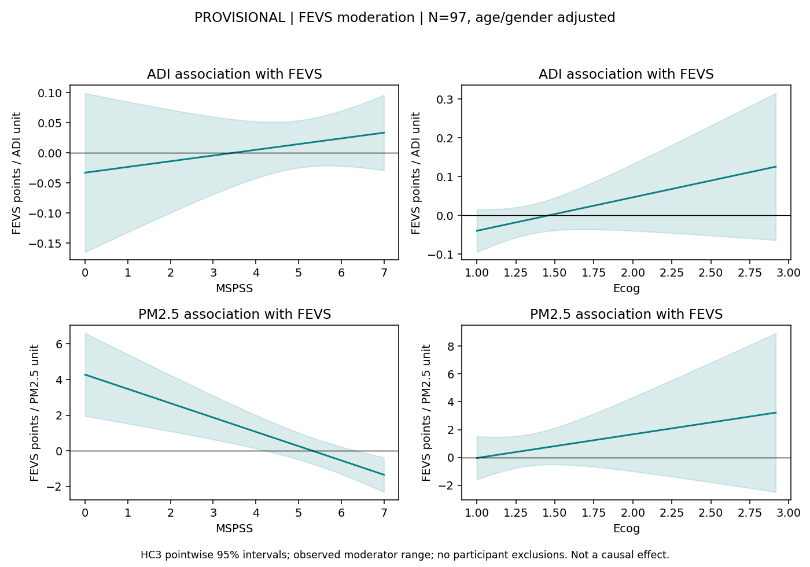
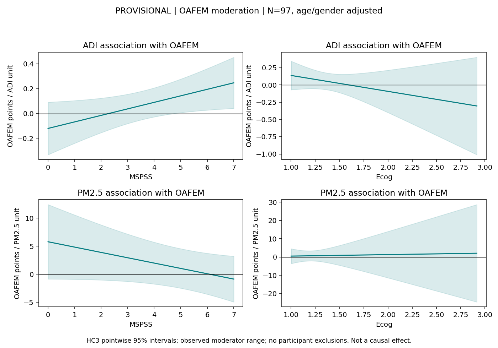

# Provisional Behavioral Moderation: Frozen N=97

PROVISIONAL: complete exported totals used as supplied. Item scoring, version, timepoint and missing-item rules are not yet verified. Do not treat this report as final.
MSPSS zero values retained: 1. Their coding validity is unresolved; zero was not silently recoded as missing.
FEVS/support models are primary (2 interactions); FEVS/Ecog and all OAFEM models are secondary (6).
All eight models retain both main terms, age and gender. No three-way terms, imaging QC covariates, transformations or exclusions.
OLS, HC3 two-sided t intervals/tests, df=91. Raw p and within-family Holm p are both reported; no significance-based model selection.
OAFEM is a distinct reported-exploitation outcome, not a replication of FEVS contextual vulnerability.
Conditional-slope bands are pointwise, not simultaneous. These associations do not establish causality or mediation.
FEVS financial/relational distress content overlaps conceptually with exposures/support; interpret accordingly.
Item scoring is checked against the supplied key; instrument authenticity/timepoint selection require source documentation.

| Outcome | Exposure | Moderator | Family | Interaction beta | HC3 95% CI | HC3 p | Holm p |
|---|---|---|---|---:|---|---:|---:|
| fevs | adi | mspss | primary | 0.009491 | [-0.01545, 0.03443] | 0.4516 | 0.4516 |
| fevs | adi | ecog | secondary | 0.08638 | [-0.03147, 0.2042] | 0.1489 | 0.5954 |
| fevs | pm25 | mspss | primary | -0.8022 | [-1.208, -0.3963] | 0.0001682 | 0.0003364 |
| fevs | pm25 | ecog | secondary | 1.703 | [-1.777, 5.182] | 0.3336 | 0.9363 |
| oafem | adi | mspss | secondary | 0.05256 | [0.002719, 0.1024] | 0.03897 | 0.2338 |
| oafem | adi | ecog | secondary | -0.2309 | [-0.682, 0.2203] | 0.3121 | 0.9363 |
| oafem | pm25 | mspss | secondary | -0.9501 | [-2.05, 0.1493] | 0.08945 | 0.4472 |
| oafem | pm25 | ecog | secondary | 0.8146 | [-14.58, 16.21] | 0.9165 | 0.9363 |

See diagnostics.tsv for influence and leave-one-out summaries. Flags never remove participants.
This is a new bounded exploratory behavioral family specified after the neural analyses, not preregistered.
Completed neural inputs/results, masks, quality rules and exclusions were not readjusted.
