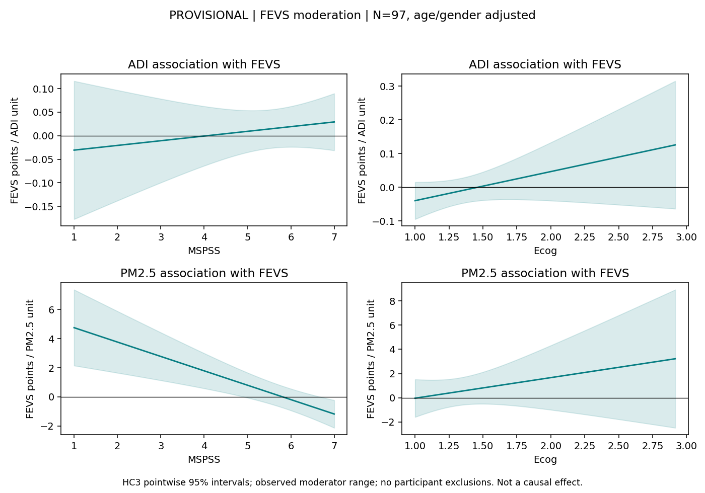
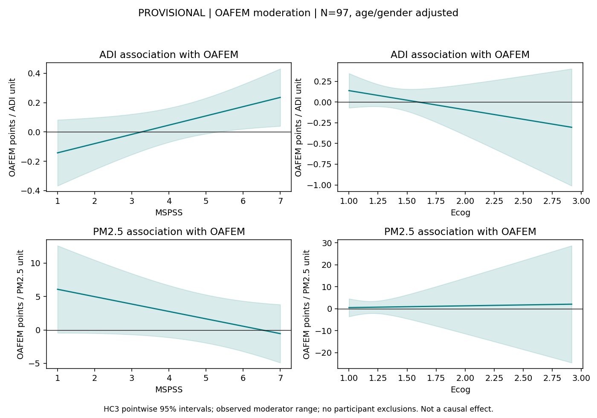

# Corrected MSPSS Behavioral Analyses: Provisional Financial Scores

Validated frozen N=97. Corrected Island screener MSPSS means replace the old support values; 82 change, 15 do not.
The acquisition team's revised November 5 export supplies these means; no independent item-level MSPSS rescore is claimed.
Selected screener records are retained, including repeat screeners after scan; not prescan retest or averaged administrations.
FEVS/OAFEM item scoring, instrument versions, missing-item rules and timepoints remain unverified. Financial totals are unchanged and results remain PROVISIONAL.
Corrected MSPSS means are in 1..7; no zero remains. Age, gender, exposures, Ecog, cohort and exclusions are unchanged.
Eight original OLS/HC3 models are reproduced with the corrected support values. Ecog models' raw estimates are unchanged; secondary Holm values are recalculated within the original six-test family.
Two FEVS/MSPSS interactions are primary; six other interactions are secondary. Both main terms and age/gender remain included, df=91.
These are exploratory cross-sectional conditional associations, not causal effects, mediation or prediction. Financial scale content overlaps conceptually with contextual predictors.

## Moderation

| Outcome | Exposure | Moderator | Interaction beta | HC3 95% CI | HC3 p | Family Holm p |
|---|---|---|---:|---|---:|---:|
| fevs | adi | mspss | 0.0099662 | [-0.020895, 0.040827] | 0.522825 | 0.522825 |
| fevs | adi | ecog | 0.086383 | [-0.031472, 0.20424] | 0.14885 | 0.595401 |
| fevs | pm25 | mspss | -0.98883 | [-1.5047, -0.47294] | 0.00025452 | 0.000509039 |
| fevs | pm25 | ecog | 1.7026 | [-1.7769, 5.1821] | 0.333644 | 0.936252 |
| oafem | adi | mspss | 0.062921 | [0.0043632, 0.12148] | 0.0354999 | 0.213 |
| oafem | adi | ecog | -0.23088 | [-0.68205, 0.22029] | 0.312084 | 0.936252 |
| oafem | pm25 | mspss | -1.1049 | [-2.4212, 0.21151] | 0.0989105 | 0.494552 |
| oafem | pm25 | ecog | 0.81465 | [-14.583, 16.212] | 0.916532 | 0.936252 |

## FEVS / PM2.5 / Support Sensitivity Checks

FEVS ~ PM2.5 + MSPSS + PM2.5:MSPSS + age + gender + listed additive covariates.
Same four requested fits, all reported; HC3 two-sided t inference. Sensitivity p values are unadjusted across these correlated fits, not independent replications.

| Added covariates | N | Interaction beta | HC3 95% CI | HC3 p | Single-case LOO beta range |
|---|---:|---:|---|---:|---|
| baseline | 97 | -0.98883 | [-1.5047, -0.47294] | 0.00025452 | [-1.1837, -0.90025] |
| adi | 97 | -0.98992 | [-1.5128, -0.46699] | 0.000300894 | [-1.1841, -0.89116] |
| ecog | 97 | -0.88336 | [-1.4063, -0.36047] | 0.00115881 | [-1.0495, -0.73242] |
| adi+ecog | 97 | -0.87862 | [-1.4092, -0.34805] | 0.00143482 | [-1.0509, -0.73483] |

Slope bands are pointwise HC3 95% intervals over observed moderator ranges, not simultaneous intervals.
See comparison.tsv and adjustment_comparison.tsv for old versus corrected estimates. Historical reports remain archived, not overwritten.
Diagnostics retain every participant; no influence-based exclusion, transformation, imputation or new model was added.
No neural images are read and no neural inference is run. Participant-level influence diagnostics and source details remain outside the published report.
