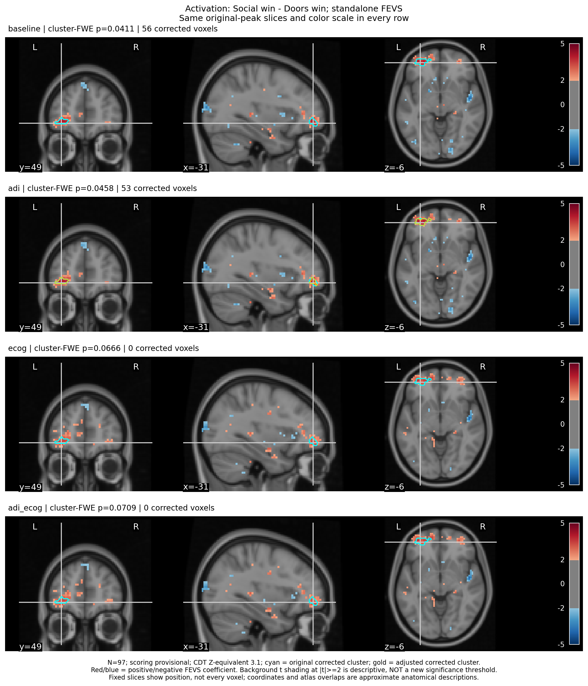
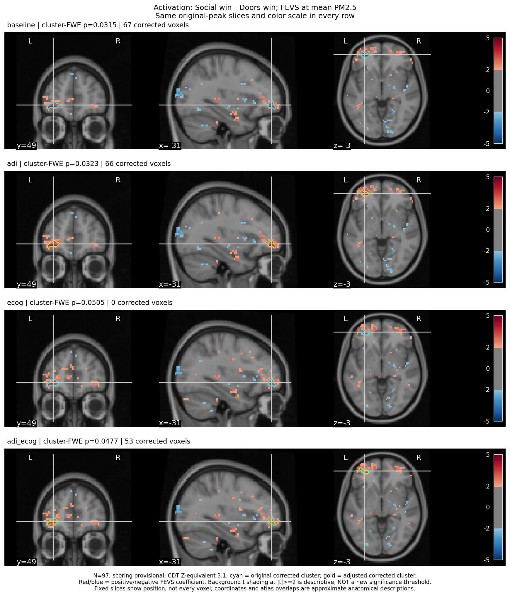
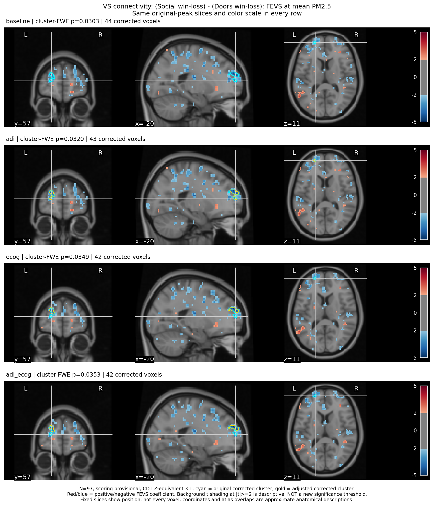

# Original And Adjusted FEVS Map Locations

N=97; read-only review; scoring provisional; no new inference or exclusions.
Three predefined original findings, four conditions each. Both CDTs and directions remain in the full adjustment report; this anatomy review focuses on the original directions at CDT 3.1.
Every row uses original-peak slices and a common within-target color scale. Cyan contours: original corrected cluster; gold: adjusted corrected cluster.
The |t|>=2 background shading is descriptive, NOT a significance criterion. An absent gold contour means no corrected cluster, not a proven absent association.
Dice/overlap and atlas nearest-voxel labels describe location, not independent replication or tissue segmentation. A shifted peak can remain inside the same cluster.

## Activation: Social win - Doors win; standalone FEVS

| Added | FWE p | Voxels | Overlap | Dice | Peak MNI mm | Shift mm | Peak in original |
|---|---:|---:|---:|---:|---|---:|---|
| baseline | 0.0411 | 56 | 56 | 1.000 | -31.6, 49.5, -6.7 | 0.0 | True |
| adi | 0.0458 | 53 | 53 | 0.972 | -31.6, 49.5, -6.7 | 0.0 | True |
| ecog | 0.0666 | 0 | 0 | n/a | none | n/a | None |
| adi_ecog | 0.0709 | 0 | 0 | n/a | none | n/a | None |

## Activation: Social win - Doors win; FEVS at mean PM2.5

| Added | FWE p | Voxels | Overlap | Dice | Peak MNI mm | Shift mm | Peak in original |
|---|---:|---:|---:|---:|---|---:|---|
| baseline | 0.0315 | 67 | 67 | 1.000 | -31.6, 49.5, -3.7 | 0.0 | True |
| adi | 0.0323 | 66 | 65 | 0.977 | -31.6, 49.5, -3.7 | 0.0 | True |
| ecog | 0.0505 | 0 | 0 | n/a | none | n/a | None |
| adi_ecog | 0.0477 | 53 | 43 | 0.717 | -18.1, 54.9, -6.7 | 14.8 | True |

## VS connectivity: (Social win-loss) - (Doors win-loss); FEVS at mean PM2.5

| Added | FWE p | Voxels | Overlap | Dice | Peak MNI mm | Shift mm | Peak in original |
|---|---:|---:|---:|---:|---|---:|---|
| baseline | 0.0303 | 44 | 44 | 1.000 | -20.8, 57.6, 11.2 | 0.0 | True |
| adi | 0.0320 | 43 | 43 | 0.989 | -23.5, 54.9, 26.0 | 15.3 | True |
| ecog | 0.0349 | 42 | 32 | 0.744 | -20.8, 54.9, 26.0 | 15.1 | True |
| adi_ecog | 0.0353 | 42 | 32 | 0.744 | -20.8, 54.9, 26.0 | 15.1 | True |
