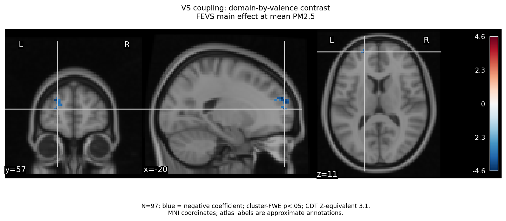
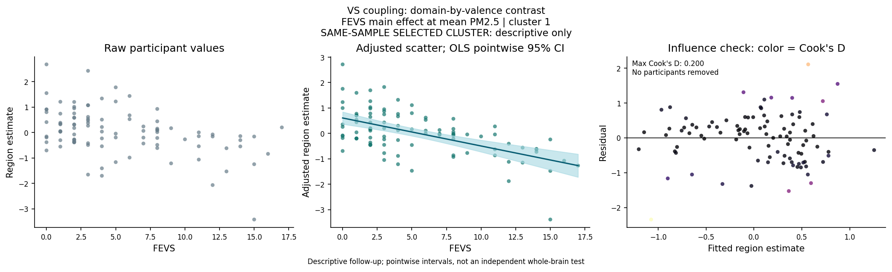

# FEVS and VS Connectivity: Domain-by-Valence Contrast

N=97; settled exclusions, running jobs and completed results unchanged.
Outcome: `[Social VS PPI(win-loss)] - [Nonsocial VS PPI(win-loss)]`. This is a difference of task-modulated VS coupling, not activation or win-only connectivity.
Target: negative FEVS main effect at mean PM2.5, from the full FEVS + PM2.5 + FEVS x PM2.5 model. This is NOT the interaction.
Other covariates remain age, gender, scanner era, signed FD and tSNR differences. Blue indicates a negative coefficient.
A negative coefficient means a decreasing social-minus-nonsocial valence-related coupling difference with FEVS; it does not by itself imply globally weaker VS connectivity or isolate winning versus losing.
Cluster-FWE p<.05, CDT Z-equivalent 3.1; mapwise correction only, not across exploratory models/outcomes/CDTs.
Raw and adjusted scatters retain all 97 participants. The adjusted slope is conditional at mean PM2.5, not a JN/moderation plot.
HC3 intervals, Cook's D, leverage and leave-one-out coefficients describe influence; no participant is removed and no voxelwise sensitivity analysis is rerun.
Selected-cluster scatterplots/intervals are descriptive, not independent confirmation. Atlas annotations are approximate MNI labels.
Only aggregate figures/tables are published; input fingerprints and participant diagnostics stay outside this report.

| Cluster | Voxels | Cluster-FWE p | Peak MNI x, y, z | Atlas |
|---|---:|---:|---|---|
| 1 | 44 | 0.0303 | -20.8, 57.6, 11.2 | HarvardOxford-cort: Frontal Pole; HarvardOxford-sub: Left Cerebral White Matter |

## fevs-vs-cluster-1 location

## fevs-vs-cluster-1 raw/adjusted scatter and influence

