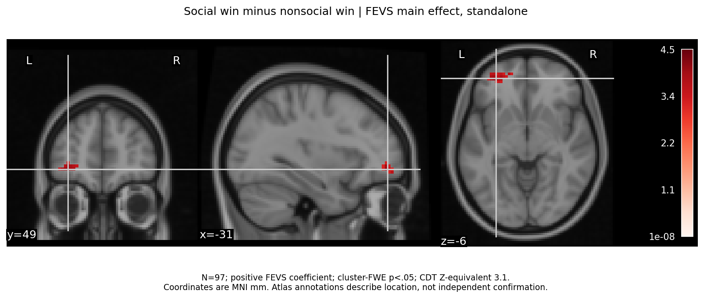
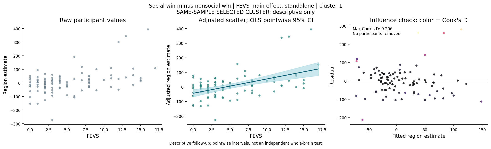
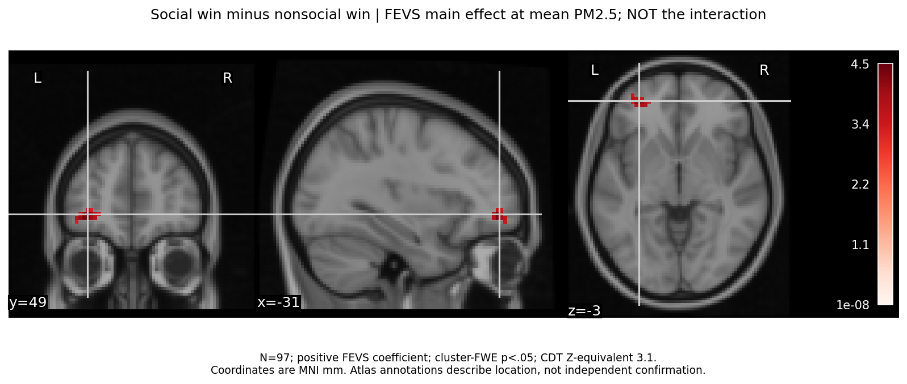
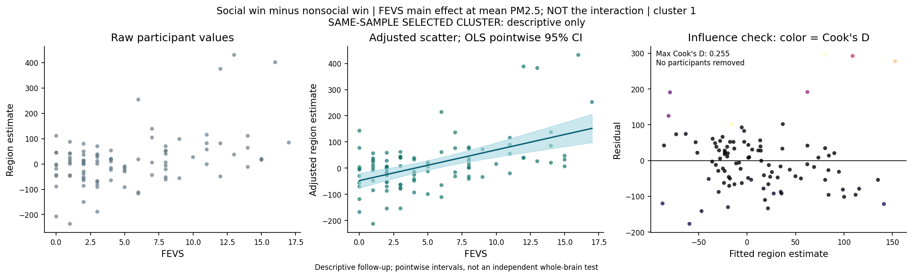

# FEVS: Social Win Minus Nonsocial Win

N=97; settled exclusions unchanged. No inference or preprocessing rerun.
These are the two preselected positive FEVS main effects at CDT Z-equivalent 3.1, cluster-FWE p<.05.
The FEVS x PM2.5 model plot is conditional at mean PM2.5, NOT a moderation/JN plot.
Cluster-selected scatterplots/intervals are descriptive and not independent confirmation.
All 97 participants remain in every scatterplot; influence flags do not create exclusions.
The models share participants and outcome images and are not independent replications.
Both models adjust for age, gender, scanner era, signed FD and tSNR differences. The conditional model also includes PM2.5 and FEVS x PM2.5.
Cluster-FWE applies per map, not across the exploratory models, outcomes, directions and thresholds.
Atlas labels use nearest-neighbor MNI coordinate lookup in local Harvard-Oxford max-probability 25% atlases; labels are approximate anatomical annotations.
No masks/statistical images, subject tables or participant-level influence files are published.

| Model | Cluster | Voxels | Cluster-FWE p | Peak MNI x, y, z | Peak Atlas Label |
|---|---:|---:|---:|---|---|
| fevs | 1 | 56 | 0.0411 | -31.6, 49.5, -6.7 | HarvardOxford-cort: Frontal Pole; HarvardOxford-sub: Left Cerebral White Matter |
| fevsxpm25 | 1 | 67 | 0.0315 | -31.6, 49.5, -3.7 | HarvardOxford-cort: Unlabeled; HarvardOxford-sub: Left Cerebral White Matter |

Overlap: `{"intersection_voxels": 48, "union_voxels": 75, "dice": 0.7804878048780488, "peak_distance_mm": 2.9700000286102295}`

## FEVS main effect, standalone

## fevs-cluster-1 raw/adjusted scatter and influence

## FEVS main effect at mean PM2.5; NOT the interaction

## fevsxpm25-cluster-1 raw/adjusted scatter and influence

