# Katie / Social Doors: Full Results Summary

## Bottom Line

The completed exploratory analyses support a **contrast-dependent pattern**, not
one general increase or decrease in "social reward processing."

1. Both tasks show a clear group win-minus-loss response. The paired social-minus-nonsocial
   valence contrast is not significantly different from zero at the group level.
2. Higher FEVS is associated with greater **social-win-minus-nonsocial-win activation**
   in a small left anterior/ventral frontal region near OFC. The finding remains
   in the FEVS/PM2.5 interaction model as the FEVS slope at mean PM2.5.
3. The original **social-by-valence activation** analyses are null across the final
   scientific catalog. The winning-component finding does not overturn that null.
4. VS connectivity has associations involving financial scores, Ecog and
   environmental exposures. The contrast, tested coefficient and influence profile
   determine what each association means. Some interaction plots are sensitive to
   influential participants.
5. This does **not** establish a simple PM2.5-to-vmPFC social-reward activation effect,
   mediation, causality, financial vulnerability prediction or longitudinal decline.

All figures below are existing validated figures, not new inferential analyses.
Only the aggregate final-count plot and reconciled corrected-map table are new.
Newly completed OAFEM/Ecog social-winning connectivity clusters still need their
anatomical and influence figures; no locations are invented for them here.

## What Is Finished

- Frozen N=97, ses-01, approved age-55+ imaging pool; screener ages 55-89.
- The 110-person linked workbook yielded 97 paired eligible participants, preserving
  11 existing FD/tSNR pair exclusions and two Doors coverage exclusions.
- Coverage remains at least 95%, with the settled task/session FD/tSNR rules.
  No TEDANA-component exclusion or effect-size-based exclusion was added.
- No-TEDANA sm-5 FEAT inputs; no experimental 6-mm images substituted.
- Both activation and original VS-seeded PPI; no alternative mPFC seed was tested.
- 194 activation source COPEs and 194 compatible PPI source COPEs in exact
  participant order; feedback timing, paired arithmetic and source lineage checked.
- All 220 extension jobs complete, zero failures, zero pending; final native-output
  and source validation passed. The six additive component jobs were preserved/reused.
- The final scientific catalog has 1,328 directional/CDT maps, including 332 retained
  maps. Group-average task checks are separate from that catalog.
- The latest read-only extraction verified all 996 extension maps and their
  source/result fingerprints; N=97 and settled exclusions are unchanged.

This report reconciles the published aggregate evidence; it is not a new native-image
integrity audit. See [completion provenance](../../../docs/final-computation.md).

## Contrasts And Models

Let S denote Social Doors and D denote nonsocial Doors. The outcomes are:

| Outcome | Formula | Interpretation |
| --- | --- | --- |
| Social modulation of valence | (S win - S loss) - (D win - D loss) | Does win-versus-loss differentiation differ between domains? |
| Social-specific winning | S win - D win | Does responding during wins differ between domains? Not win minus loss. |
| Social-specific losing | S loss - D loss | Does responding during losses differ between domains? |
| Domain-average valence | 0.5 * [(S win - S loss) + (D win - D loss)] | Reward-valence response shared/averaged across domains; not social-specific. |

For PPI these are **differences in task-modulated VS coupling**, not activation
or general connectivity strength. A negative coefficient need not mean globally
weaker connectivity. Opposite signs can occur in different targets.

Models cover ADI, PM2.5, their separate MSPSS/Ecog interactions, separate FEVS
and OAFEM predictors, and each financial score interacting separately with
MSPSS, ADI, PM2.5 or Ecog. The additive PM2.5+Ecog model covers the three domain
contrasts. All interaction models include both main terms; no three-way terms.

Age, source gender-code indicator, scanner-era indicators and FD/tSNR covariates
are retained. Domain contrasts use signed Social-Doors quality differences;
the average uses pair-mean quality. Main effects in interaction models describe
the slope at the **mean of the other predictor**, not an interaction.

Inference: 10,000 permutations, seed 20261101, cluster extent at Z-equivalent
CDTs 2.6 and 3.1, converted to t using model-specific residual df. Per-map
cluster-FWE p<0.05, **not** joint correction across the exploratory search.

## Final Inventory

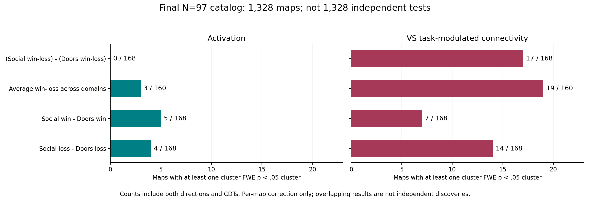

| Contrast | Activation: corrected / tested maps | VS connectivity: corrected / tested maps |
| --- | ---: | ---: |
| Social modulation of valence | 0 / 168 | 17 / 168 |
| Domain-average valence | 3 / 160 | 19 / 160 |
| Social win - nonsocial win | 5 / 168 | 7 / 168 |
| Social loss - nonsocial loss | 4 / 168 | 14 / 168 |

There are 69 maps containing corrected clusters, **not 69 independent findings**.
CDTs, models, outcomes and directions overlap. The complete corrected-map
[aggregate table](corrected_maps.tsv) includes all 69, with terms, directions,
CDTs, minimum cluster-FWE p, significant voxels and cluster counts. All null maps
remain in the canonical Linux2 final `maps.tsv`; this smaller table intentionally
contains only corrected maps. Do not treat map counts as evidence that one
modality is statistically more sensitive than the other.

## Task Signal Is Present

The group mean win-minus-loss response is significant for Social Doors, Doors
and their average at both CDTs. The average map has minimum cluster-FWE
p approximately 0.0001. These are task effects, not exposure/financial-score effects.

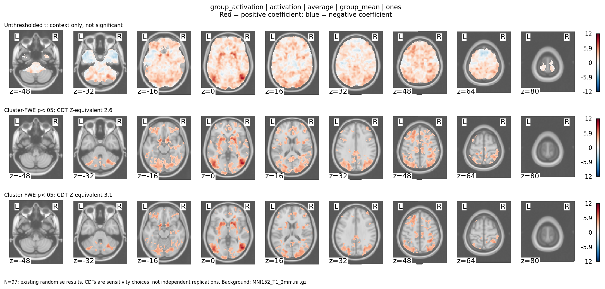

Descriptive anatomical VS means are 61.0 for Social Doors, 72.3 for Doors and
66.6 for their average (arbitrary COPE units). The mean paired valence difference
is -11.3, with descriptive 95% interval [-29.6, 7.1]. These ROI summaries do not
replace the whole-brain group tests and do not measure raw BOLD percent change.

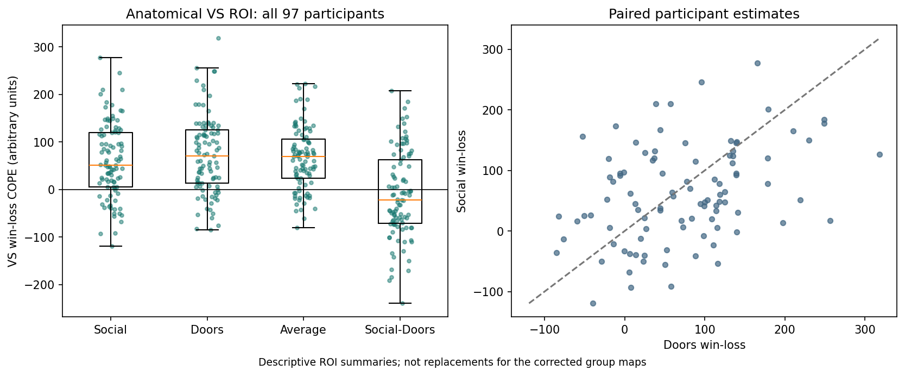

## Activation: FEVS And Social-Specific Winning

This is the most directly reviewed FEVS activation result relevant to social winning.

| Model | Sign | CDT | Voxels | Cluster-FWE p | Peak MNI |
| --- | --- | ---: | ---: | ---: | --- |
| FEVS predictor | Positive | 3.1 | 56 | 0.0411 | [-31.6, 49.5, -6.7] |
| FEVS at mean PM2.5 in FEVS x PM2.5 model | Positive | 3.1 | 67 | 0.0315 | [-31.6, 49.5, -3.7] |

The clusters overlap by 48 voxels (Dice 0.78); peaks are 3 mm apart. They are
related fits to the same participants and outcome, **not replications**. The
second fit includes PM2.5 and FEVS x PM2.5, rather than merely adding PM2.5.
Neither FEVS activation map passes at CDT 2.6.

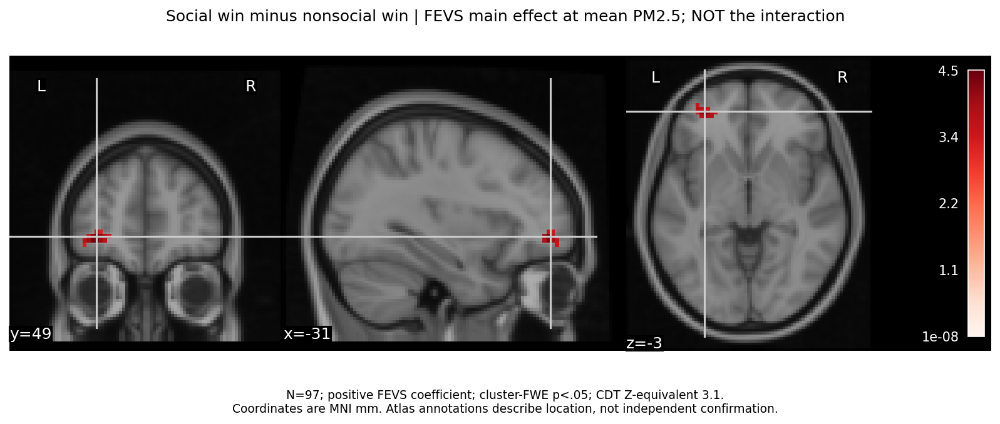

Location is left anterior/ventral frontal pole near OFC, **not a demonstrated
vmPFC or VS activation association**. Atlas overlap is mostly white-matter-labeled
(79% and 66% of the respective clusters), so report coordinates and cautious
anatomy rather than calling this a clean cortical vmPFC effect.

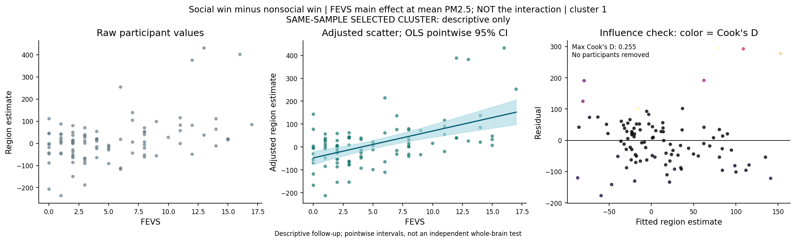

Standalone selected-cluster slope: 9.79, HC3 interval [4.04, 15.54]; all single-case
leave-one-out slopes remain positive, 7.86-10.44. Conditional slope: 11.74,
HC3 [4.31, 19.17], leave-one-out 9.70-12.66. Maximum Cook's D is 0.206/0.255.
This argues against a single observation reversing the descriptive slope; it
does not establish robustness to jointly removing several observations or
re-running voxelwise inference. No participants were removed.

## Activation: Other Corrected Effects

The other social-winning activation maps are a positive ADI x MSPSS interaction
(CDT 2.6, p=0.0492, 208 voxels) and a negative Ecog main effect at mean OAFEM
(CDTs 2.6/3.1, p=0.0492/0.0453). These bring the winning total to five maps.
The ADI x MSPSS cluster has no targeted anatomical/influence report yet.

The reviewed Ecog cluster is left superior lateral occipital cortex, peak
[-58.6, -63.9, 20.1], 61 voxels at CDT 3.1. This is an Ecog main effect, not
evidence of OAFEM moderation. Selected-cluster slope -176.35; HC3 [-308.26,
-44.43]; leave-one-out -188.21 to -119.41; maximum Cook's D 0.665. Its magnitude
is sensitive to individual observations, although no single omission flips sign.

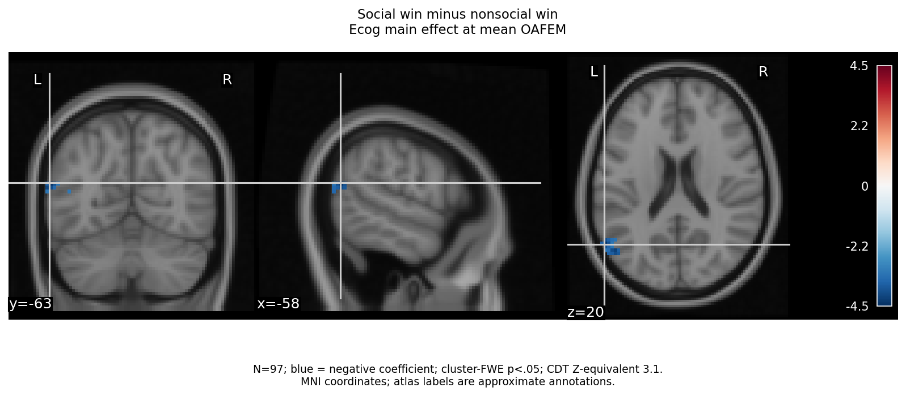

The domain-average activation findings are a positive FEVS x Ecog interaction
(CDT 2.6, p=0.0416) and negative Ecog at mean OAFEM (CDT 2.6/3.1,
p=0.0250/0.0069). They are **not social-specific** and should not be substituted
for the null social-by-valence activation result.

## VS Connectivity: Reviewed FEVS Main Effect

For **social-by-valence VS PPI**, FEVS at mean PM2.5 has a negative association
with a left frontal-pole target: CDT 3.1, p=0.0303, 44 voxels, peak
[-20.8, 57.6, 11.2]. This target is not the VS seed. It is not a social-winning-only
contrast and not the FEVS x PM2.5 interaction.

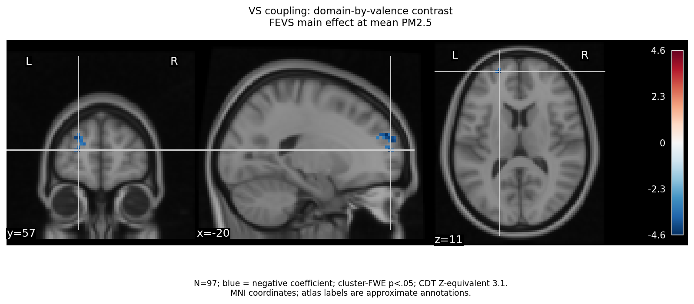

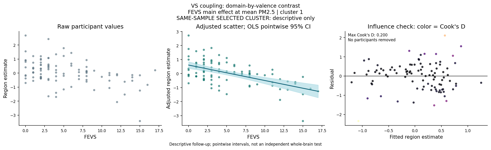

Selected-cluster slope -0.110; HC3 [-0.155, -0.066]; leave-one-out -0.114 to
-0.098, maximum Cook's D 0.200. No single omission changes direction. Most of
the cluster is cortex-labeled (84%), but the peak is white-matter-labeled;
coordinates and anatomical caution still matter. There is **no corrected FEVS
effect in social-win-minus-nonsocial-win VS connectivity** in the final catalog.

## VS Connectivity: Environmental And Financial Interactions

All of the following refer to **social-by-valence coupling**, not winning alone.
The table groups related corrected maps; p is the best mapwise cluster p over
the two CDTs, not a jointly corrected result.

| Interaction | Direction | Corrected CDTs | Best cluster-FWE p | Reviewed influence |
| --- | --- | --- | ---: | --- |
| ADI x Ecog | Positive | 2.6 and 3.1 | 0.0383 | Single-case slopes retain sign; substantial influence |
| PM2.5 x Ecog | Positive and negative targets | 2.6 and 3.1 | 0.0194 positive; 0.0167 negative | Some clusters have Cook's D > 1 and one HC3 interval includes zero |
| FEVS x Ecog | Negative | 2.6 and 3.1 | 0.0284 | Strong influence; HC3 intervals include zero |
| OAFEM x ADI | Negative | 2.6 | 0.0311 | Reviewed single-case slopes retain sign |
| OAFEM x Ecog | Negative | 2.6 and 3.1 | 0.0026 | Multiple posterior targets; influence varies by cluster |

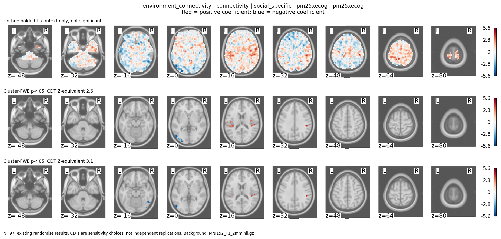

The PM2.5 x Ecog targets have posterior temporal/parietal and occipital peak
coordinates rather than establishing a vmPFC activation effect. Different targets
have different signs; this is not a global increase/decrease in VS coupling.

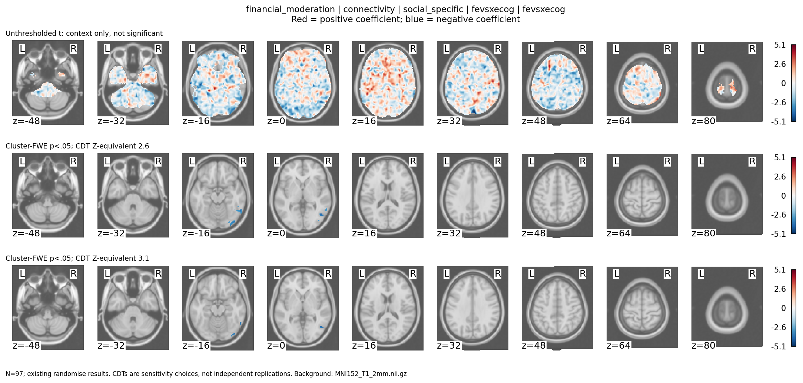

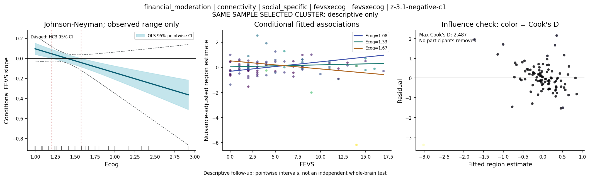

For the CDT 3.1 FEVS x Ecog cluster, the ROI interaction is -0.239, but HC3
[-0.564, 0.085] includes zero; maximum Cook's D is 2.49 and the least negative
leave-one-out slope is -0.090. This is a **fragile interaction**, despite the
original corrected map. Do not present the JN region as independent confirmation.
No new exclusions or voxelwise deletion analysis were made.

The strongest mapwise OAFEM x Ecog interaction is worth documenting, but it is
not evidence that OAFEM is "better" than FEVS. The scales/models are not a formal
head-to-head predictive comparison.

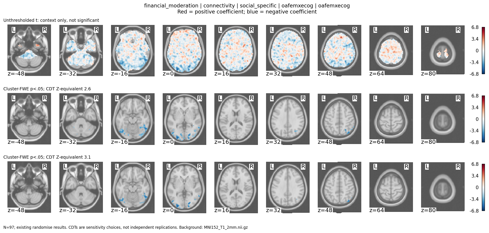

## VS Connectivity: Final Social-Winning Maps

Seven maps pass for **Social win - Doors win**. They test main effects in adjusted
models, **not any interaction**:

| Tested coefficient | Context | Direction | CDT | Cluster-FWE p | Voxels |
| --- | --- | --- | ---: | ---: | ---: |
| OAFEM | Mean Ecog, OAFEM x Ecog model | Positive | 3.1 | 0.0264 | 86 |
| OAFEM | Mean Ecog, same model, different target | Negative | 3.1 | 0.0297 | 67 |
| OAFEM | Mean Ecog, OAFEM x Ecog model | Positive | 2.6 | 0.0310 | 274 |
| OAFEM | Mean MSPSS, OAFEM x MSPSS model | Positive | 3.1 | 0.0441 | 55 |
| Ecog | Mean ADI, ADI x Ecog model | Positive | 3.1 | 0.0479 | 50 |
| Ecog | Mean OAFEM, OAFEM x Ecog model | Positive | 2.6 | 0.0487 | 144 |
| Ecog | Additive PM2.5 adjustment | Positive | 2.6 | 0.0497 | 165 |

Their identities are validated, but the published extraction has no cluster
coordinates, brain images or influence follow-ups for these seven maps yet.
Do not claim OFC/vmPFC/other anatomy for them until those files are reviewed.

## Loss Findings: Secondary / Supplementary

The reviewed negative **FEVS x PM2.5 activation interaction** is for Social loss
minus Doors loss: left superior parietal cluster, peak [-26.2, -42.3, 61.7],
90 voxels, CDT 3.1, p=0.0495. This is a loss-related result, not a winning effect.

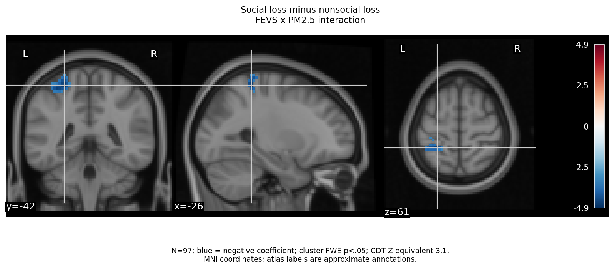

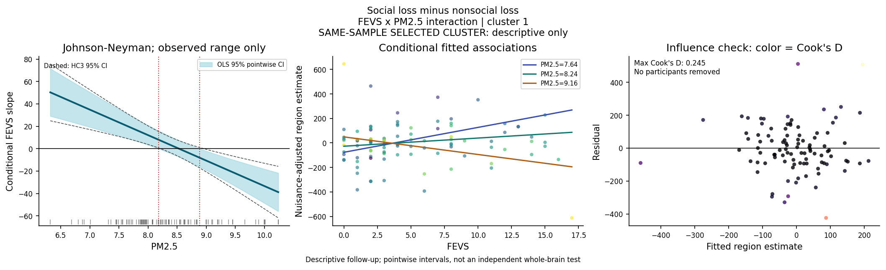

The descriptive FEVS slope becomes more negative as PM2.5 increases. HC3 JN
boundaries are about 8.21 and 8.96 in the recorded PM2.5 units, within the observed
range. Those values are selected-cluster pointwise descriptions, **not exposure
safety thresholds or independently corrected subgroup findings**. Interaction
slope -22.74, HC3 [-34.58, -10.91], all leave-one-out slopes remain negative.

The reviewed Ecog loss effect at mean PM2.5 is right postcentral, p=0.0318;
maximum Cook's D 1.64, HC3 interval [-352.09, 24.00]. Its fragility makes it a
poor centerpiece. Ecog at mean OAFEM also has corrected loss activation maps
(p=0.0190/0.0138), without a dedicated targeted report yet.

Loss-related VS coupling has 14 corrected maps, including OAFEM main effects,
negative ADI x Ecog and OAFEM x ADI interactions, and a positive OAFEM x Ecog
interaction. The smallest p is 0.0007 for OAFEM at mean ADI (CDT 2.6); that is
**not** the OAFEM x ADI interaction. Anatomy for these newer targets is not yet
reviewed here. All terms/directions/CDTs are in the aggregate table.

## Correlations And The Behavioral Story

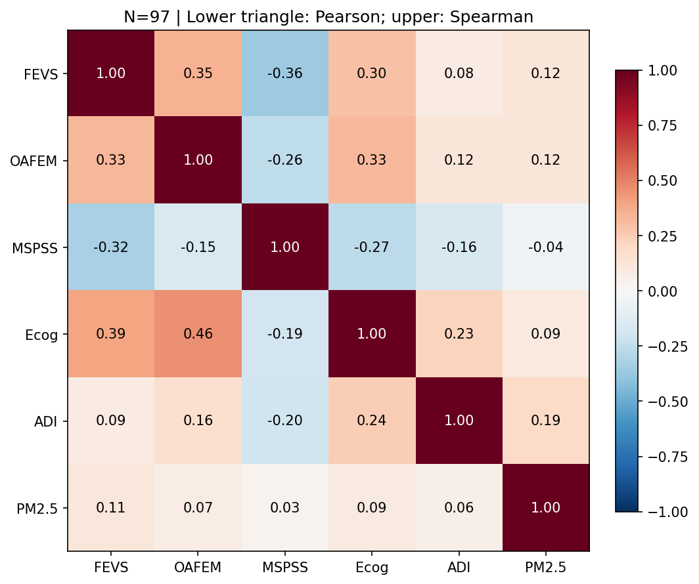

Descriptive Pearson correlations, N=97:

- FEVS with Ecog: 0.393; with MSPSS: -0.322; with OAFEM: 0.335.
- OAFEM with Ecog: 0.458; with MSPSS: -0.153.
- FEVS with ADI: 0.085; with PM2.5: 0.111.
- ADI with PM2.5: 0.062; with Ecog: 0.243; with MSPSS: -0.201.
- PM2.5 with Ecog: 0.087; with MSPSS: 0.034.

Financial vulnerability is more clearly correlated with cognitive concerns and
lower perceived support than with the environmental measures in these unadjusted
summaries. That does not rule out moderation, but the data do not supply a simple
strong exposure-to-financial-vulnerability correlation. This is not a mediation
analysis. All neural models treat the brain estimate as the dependent variable;
they do not demonstrate out-of-sample financial vulnerability prediction.

## Interpretation And Paper Focus

The most coherent **working interpretation**, not a confirmed mechanism, is:
**financial vulnerability and cognitive concerns relate to distinct components
of social reward responses, with activation and VS coupling showing different,
contrast-specific associations.**

For a FEVS-focused paper, lead with the social-winning activation association,
its overlap across the two related models, its anatomical caveat and descriptive
influence checks. The reviewed social-by-valence FEVS coupling association is a
complementary but different outcome. Report the social-by-valence activation null.
Financial/cognitive/environmental interactions can be secondary, with fragile
effects clearly distinguished. Loss findings fit a supplement, as discussed.

For an environment-led paper, the present evidence is more naturally about
**Ecog-dependent VS coupling**, not a direct PM2.5/vmPFC activation association.
Do not retrofit the manuscript question merely to the smallest p value or
conflate conditional main effects with moderation. Preserve the tested model
inventory and null results whichever manuscript focus is chosen.

## What Remains

**No more preprocessing, participant selection or randomise runs are required
for this completed model set.** Remaining work is reporting and interpretation:

1. Make anatomical/association/influence panels for the final seven social-winning
   VS maps and the ADI x MSPSS winning-activation effect before centering them.
2. Keep new OAFEM/Ecog effects distinct from FEVS; review score meaning/coding
   from the measures documentation before assigning psychological direction.
3. Preserve the 97 participants; no exclusions based on differences, ROI slopes
   or Cook's distance. Any sensitivity analyses would be separate and documented.
4. Finalize focal versus supplementary outcomes and disclose the full exploratory
   search. Per-map cluster correction does not make the broader search confirmatory.
5. Keep the lifespan loneliness/belonging/depression project separate. No older
   preregistration is retroactively claimed to cover these exploratory decisions.

## Sources And Reproduction

- [Completion / final validation](https://github.com/DVS-Lab/rf1-sra-linux2/blob/main/logs/records/20261103-001224_reward-extension-20261103-001224.md).
- [Final status/catalog](https://github.com/DVS-Lab/rf1-sra-linux2/blob/6df2ff91/logs/records/20261103-201516_reward-extension-status-20261103-201516.md).
- [Hash-verified extension extraction](https://github.com/DVS-Lab/rf1-sra-linux2/blob/6df2ff91/logs/records/20261103-201516_reward-extension-status-20261103-201516-results.md).
- [All 69 corrected maps](corrected_maps.tsv), [provenance and report fingerprints](provenance.json).
- [Earlier 336-map illustrated review](../katie-review-v1/README.md), with original null maps and JN plots.
- [FEVS activation report](../fevs-win-v1/README.md), [FEVS PPI report](../fevs-vs-v1/README.md), [loss/Ecog report](../reward-followup-v1/README.md).

Canonical Linux2 native results remain under
`/ZPOOL/data/projects/rf1-sra-environment-SD/derivatives/fsl/randomise/katie-reward-extension-v1/`.
`maps.tsv` contains all 1,328 scientific maps; `clusters.tsv` contains passing
clusters; `validation.json`, plans and success receipts contain validation lineage.

The new aggregate table/plot can be regenerated locally from the two repositories:

```bash
python3 code/summarize_katie_final.py --logs-repo ../rf1-sra-linux2-geometry
```

This command reads pinned published logs and existing report tables only. It
checks all curated report hashes, reconciles 20 retained plus 49 extension
corrected maps against the eight final category counts, and never runs inference
or modifies completed source reports. The log-repository path in that local
reproduction command is not a new Linux2 launch instruction.
