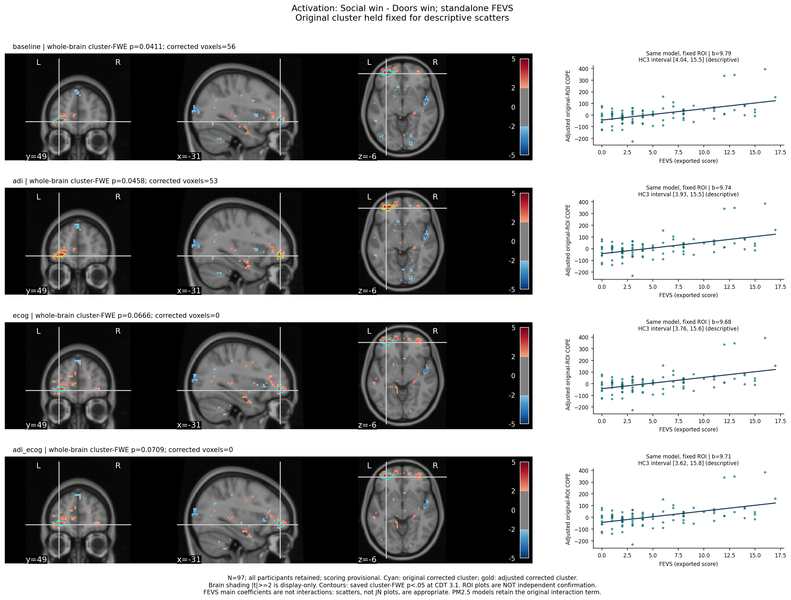
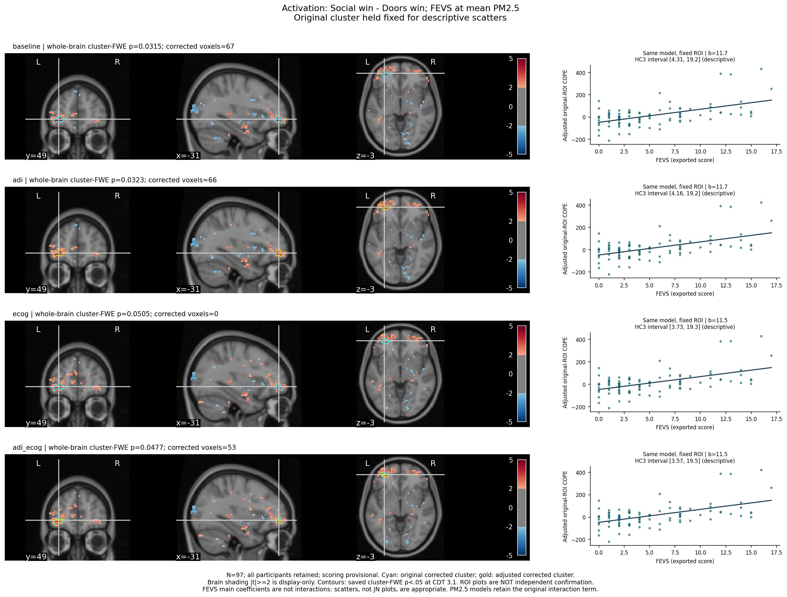
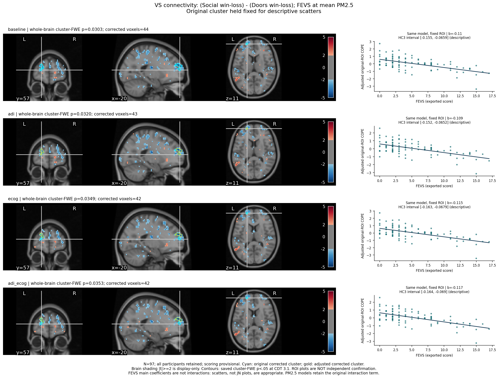
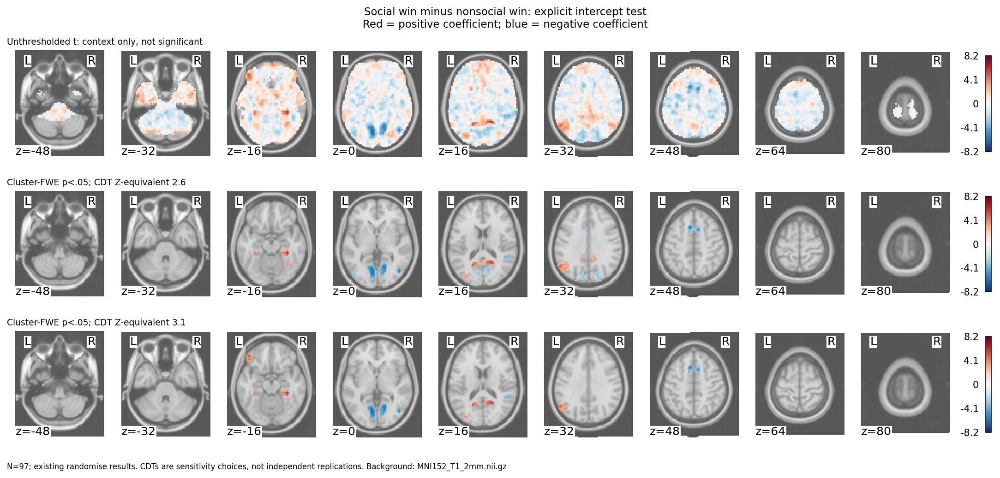
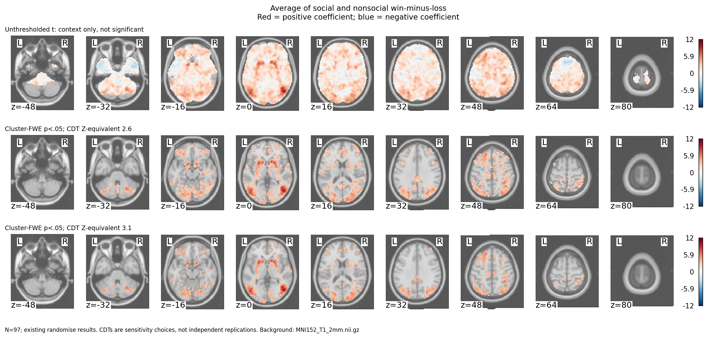
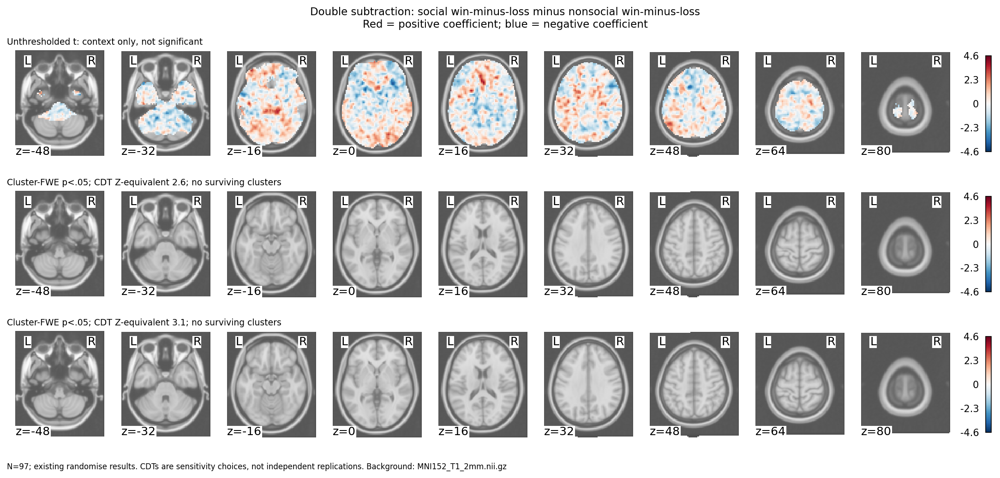
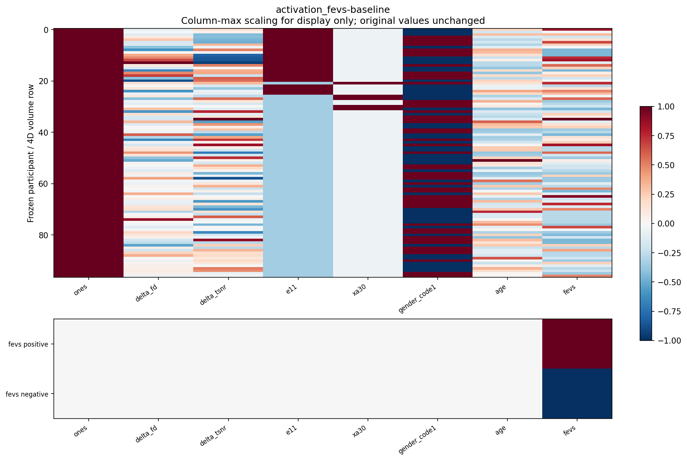
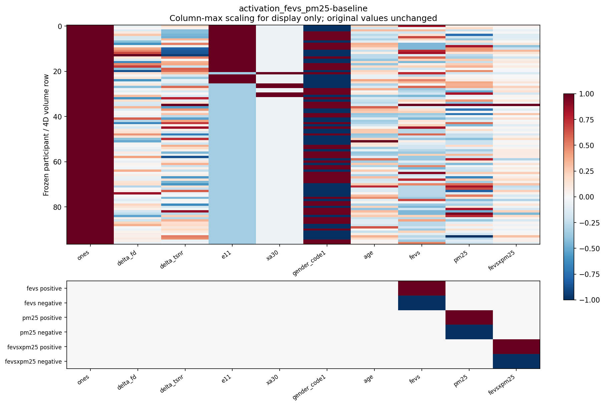
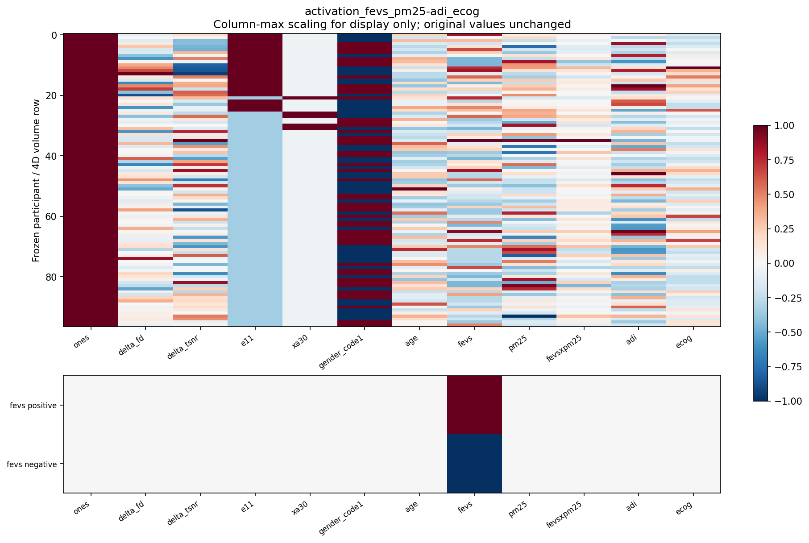
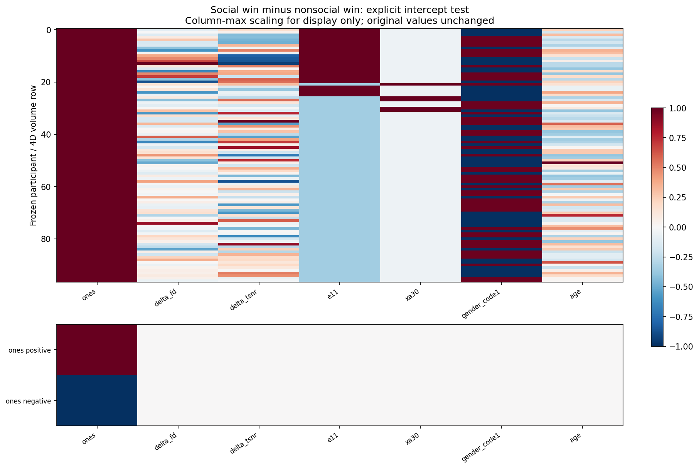

# Katie Evidence Panels: Context, Content, Conclusions

N=97; provisional scoring; no settled exclusions changed.
The column of ones does not test itself: it must be explicitly contrasted. Only two new task-mean jobs were added (social win minus nonsocial win, both CDTs); existing win-loss and double-subtraction jobs were reused.
FEVS main coefficients use scatters, not JN plots. Every scatter uses the exact corresponding model and the original corrected ROI held fixed across adjustments, including null whole-brain fits. These are selected-sample descriptive estimates, not independent inference.

## Activation: Social win - Doors win; standalone FEVS

**Context:** Does the FEVS association remain after adding ADI/Ecog?

**Content:** Rows are original, ADI, Ecog, and both; brain p-values are whole-brain cluster-FWE at CDT 3.1. Scatter slopes/HC3 intervals are descriptive, selected-ROI estimates.
**Conclusion:** Higher FEVS is associated with a larger social-winning activation contrast in the original/ADI fits, but this is not uniformly robust to Ecog adjustment. The atlas caveat prevents a clean cortical vmPFC/OFC claim. Do not treat ROI intervals as a second successful hypothesis test.

## Activation: Social win - Doors win; FEVS at mean PM2.5

**Context:** Does the FEVS association remain after adding ADI/Ecog?

**Content:** Rows are original, ADI, Ecog, and both; brain p-values are whole-brain cluster-FWE at CDT 3.1. Scatter slopes/HC3 intervals are descriptive, selected-ROI estimates.
**Conclusion:** The conditional FEVS activation location is stable, but correction is borderline and depends on adjustment. The same-sample scatter is illustrative, not a rescue of a null whole-brain fit. This is not evidence of a winning-related FEVS x PM2.5 interaction. Do not treat ROI intervals as a second successful hypothesis test.

## VS connectivity: (Social win-loss) - (Doors win-loss); FEVS at mean PM2.5

**Context:** Does the FEVS association remain after adding ADI/Ecog?

**Content:** Rows are original, ADI, Ecog, and both; brain p-values are whole-brain cluster-FWE at CDT 3.1. Scatter slopes/HC3 intervals are descriptive, selected-ROI estimates.
**Conclusion:** Higher FEVS relates to a lower social-by-valence VS-connectivity contrast with the same frontal target across ADI/Ecog adjustments at CDT 3.1. This is not global weaker connectivity or winning-specific coupling. Do not treat ROI intervals as a second successful hypothesis test.

## Group task effect: social_win

**Context:** Is the mean task contrast different from zero across the frozen 97 participants?

**Content:** Explicit +/- intercept contrasts, not a financial-score effect.
| CDT | Direction | Minimum cluster-FWE p | Corrected voxels |
|---|---|---:|---:|
| 2.6 | positive | 0.0175 | 1196 |
| 2.6 | negative | 0.0019 | 1991 |
| 3.1 | positive | 0.0021 | 762 |
| 3.1 | negative | 0.0011 | 1008 |

**Conclusion:** A corrected group-average contrast is present; inspect the sign and CDT table below.

## Group task effect: average

**Context:** Is the mean task contrast different from zero across the frozen 97 participants?

**Content:** Explicit +/- intercept contrasts, not a financial-score effect.
| CDT | Direction | Minimum cluster-FWE p | Corrected voxels |
|---|---|---:|---:|
| 2.6 | positive | 0.0001 | 19274 |
| 2.6 | negative | 0.0894 | 0 |
| 3.1 | positive | 0.0001 | 11811 |
| 3.1 | negative | 0.0508 | 0 |

**Conclusion:** A corrected group-average contrast is present; inspect the sign and CDT table below.

## Group task effect: social_specific

**Context:** Is the mean task contrast different from zero across the frozen 97 participants?

**Content:** Explicit +/- intercept contrasts, not a financial-score effect.
| CDT | Direction | Minimum cluster-FWE p | Corrected voxels |
|---|---|---:|---:|
| 2.6 | positive | 0.4232 | 0 |
| 2.6 | negative | 0.2905 | 0 |
| 3.1 | positive | 0.2414 | 0 |
| 3.1 | negative | 0.2081 | 0 |

**Conclusion:** No corrected group-average contrast was detected at either CDT in either direction. This does not establish equivalence or rule out individual-difference associations.

## Executed Designs And Contrasts

Custom heatmaps are drawn from actual executed VEST files, not inferred from a column of ones or reconstructed from a new cohort. Columns are scaled only for display. Full matrices remain unchanged and participant row labels are not published.

Native L1 design.png/design_cov.png are copied unchanged when available; availability is recorded in summary.json. Missing PNGs never trigger a FEAT rerun.
