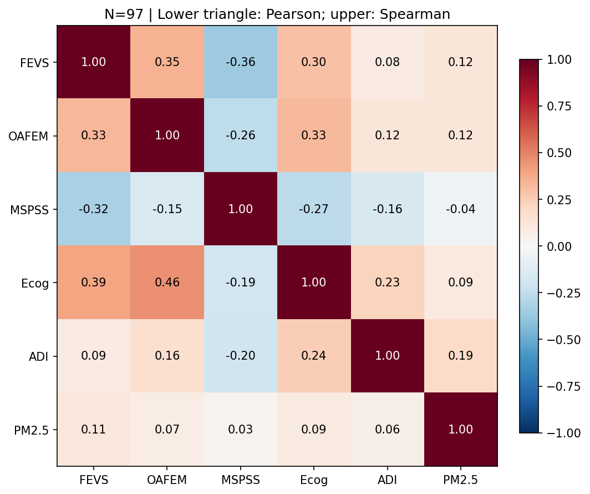
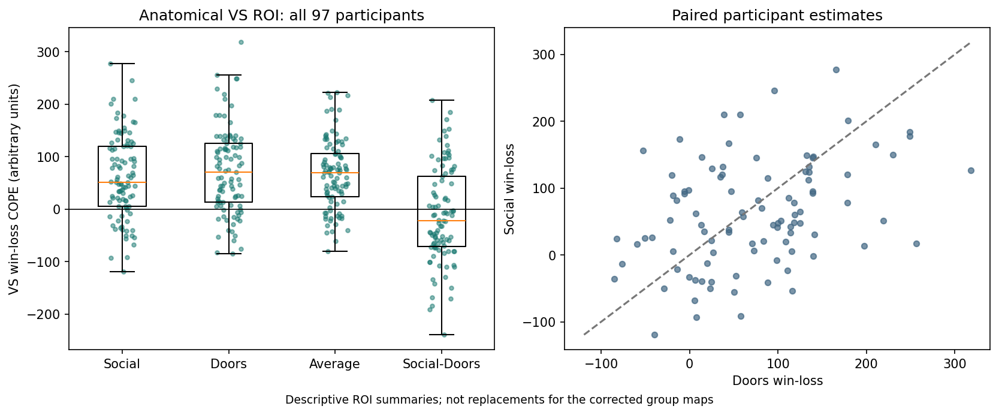

# Katie Results Review: N=97

All 152 jobs / 336 maps audited; 84 brain panels include nulls and both CDTs/directions.
Existing per-map cluster-FWE only; no additional correction across exploratory models/outcomes.
Association/JN plots from selected clusters are descriptive and circular as inferential confirmation.
JN uses observed moderator ranges and pointwise OLS/HC3 95% t intervals, not spatially corrected intervals.
No participants removed. Per-participant influence tables remain in the separate work details directory.
The dependent variable is the neural estimate, not financial vulnerability. Negative interaction terms mean the focal-score slope becomes more negative as the moderator increases.
Inputs remain the frozen no-TEDANA sm-5 FEAT variant; experimental 6-mm smoothing outputs were not substituted.

## Corrected Findings

| Batch | Family | Outcome | Model | Term | Direction | CDT | Minimum cluster-FWE p | Voxels |
|---|---|---|---|---|---|---|---|---|
| group_activation | activation | socialdoors | group_mean | ones | positive | 2.6 | 0.00010001659393310547 | 9394 |
| group_activation | activation | socialdoors | group_mean | ones | positive | 3.1 | 0.00010001659393310547 | 5044 |
| group_activation | activation | doors | group_mean | ones | positive | 2.6 | 0.00019997358322143555 | 9245 |
| group_activation | activation | doors | group_mean | ones | positive | 3.1 | 0.00010001659393310547 | 4570 |
| group_activation | activation | average | group_mean | ones | positive | 2.6 | 0.00010001659393310547 | 19274 |
| group_activation | activation | average | group_mean | ones | positive | 3.1 | 0.00010001659393310547 | 11811 |
| environment_connectivity | connectivity | social_specific | adixecog | adixecog | positive | 2.6 | 0.03829997777938843 | 188 |
| environment_connectivity | connectivity | social_specific | adixecog | adixecog | positive | 3.1 | 0.047299981117248535 | 48 |
| environment_connectivity | connectivity | social_specific | pm25xecog | pm25xecog | positive | 2.6 | 0.040499985218048096 | 383 |
| environment_connectivity | connectivity | social_specific | pm25xecog | pm25xecog | negative | 2.6 | 0.030099987983703613 | 230 |
| environment_connectivity | connectivity | social_specific | pm25xecog | pm25xecog | positive | 3.1 | 0.01940000057220459 | 131 |
| environment_connectivity | connectivity | social_specific | pm25xecog | pm25xecog | negative | 3.1 | 0.016700029373168945 | 145 |
| environment_connectivity | connectivity | average | adi | adi | negative | 3.1 | 0.019900023937225342 | 99 |
| environment_connectivity | connectivity | average | adixecog | adixecog | positive | 2.6 | 0.02249997854232788 | 259 |
| environment_connectivity | connectivity | average | adixecog | adixecog | positive | 3.1 | 0.023800015449523926 | 66 |
| financial_predictors | connectivity | average | oafem | oafem | negative | 2.6 | 0.009700000286102295 | 385 |
| financial_predictors | connectivity | average | oafem | oafem | negative | 3.1 | 0.02920001745223999 | 59 |
| financial_moderation | connectivity | social_specific | fevsxecog | fevsxecog | negative | 2.6 | 0.028400003910064697 | 235 |
| financial_moderation | connectivity | social_specific | fevsxecog | fevsxecog | negative | 3.1 | 0.028500020503997803 | 65 |
| financial_moderation | connectivity | social_specific | oafemxadi | oafemxadi | negative | 2.6 | 0.031099975109100342 | 366 |
| financial_moderation | connectivity | social_specific | oafemxecog | oafemxecog | negative | 2.6 | 0.003899991512298584 | 1753 |
| financial_moderation | connectivity | social_specific | oafemxecog | oafemxecog | negative | 3.1 | 0.0026000142097473145 | 707 |
| financial_moderation | activation | average | fevsxecog | fevsxecog | positive | 2.6 | 0.04159998893737793 | 278 |
| financial_moderation | connectivity | average | fevsxecog | fevsxecog | negative | 2.6 | 0.002200007438659668 | 965 |
| financial_moderation | connectivity | average | fevsxecog | fevsxecog | negative | 3.1 | 0.00279998779296875 | 345 |
| financial_moderation | connectivity | average | oafemxadi | oafemxadi | negative | 3.1 | 0.02799999713897705 | 114 |

## Brain Maps

- [conditional_activation | activation | average | adixmspss | mspss](figures/brain-04e14afc99661a.png)
- [financial_moderation | connectivity | social_specific | oafemxpm25 | oafemxpm25](figures/brain-057ce7b23dd814.png)
- [financial_moderation | connectivity | social_specific | fevsxecog | fevsxecog](figures/brain-0aa87a3b7a56af.png)
- [conditional_activation | activation | average | adixecog | adi](figures/brain-0c01ca096a1d5f.png)
- [conditional_activation | activation | social_specific | adixmspss | mspss](figures/brain-0e521c8eac85c6.png)
- [financial_moderation | connectivity | social_specific | fevsxpm25 | fevsxpm25](figures/brain-0f8ff48129f251.png)
- [financial_predictors | activation | average | oafem | oafem](figures/brain-12536880fe681a.png)
- [environment_connectivity | connectivity | social_specific | pm25xecog | pm25xecog](figures/brain-13faae2cd644dc.png)
- [environment_connectivity | connectivity | social_specific | adixecog | adixecog](figures/brain-1b154827ae619a.png)
- [financial_moderation | activation | social_specific | oafemxecog | oafemxecog](figures/brain-1c94faa8fe555b.png)
- [conditional_activation | activation | social_specific | pm25xmspss | pm25](figures/brain-232f9efcfa11e3.png)
- [financial_moderation | connectivity | average | fevsxecog | fevsxecog](figures/brain-25cac37adc3a84.png)
- [financial_moderation | activation | social_specific | oafemxadi | oafemxadi](figures/brain-2ae9c126f7fef6.png)
- [environment_activation | activation | social_specific | pm25 | pm25](figures/brain-2bad795d5164ba.png)
- [financial_moderation | activation | social_specific | oafemxmspss | oafemxmspss](figures/brain-2d81a7f21ec422.png)
- [conditional_activation | activation | social_specific | pm25xecog | ecog](figures/brain-3510fdf3bf6d41.png)
- [group_activation | activation | average | group_mean | ones](figures/brain-3bdb54d9c4bc23.png)
- [financial_predictors | connectivity | average | fevs | fevs](figures/brain-3f3ec61210349c.png)
- [financial_predictors | activation | social_specific | fevs | fevs](figures/brain-47c4a0dc159583.png)
- [financial_moderation | activation | social_specific | fevsxpm25 | fevsxpm25](figures/brain-482f1d3b855b9f.png)
- [environment_connectivity | connectivity | average | adi | adi](figures/brain-4c41448bca4840.png)
- [environment_connectivity | connectivity | average | adixecog | adixecog](figures/brain-4eb95bbaf4c032.png)
- [environment_activation | activation | average | adixmspss | adixmspss](figures/brain-51aec647dbcf10.png)
- [group_activation | activation | socialdoors | group_mean | ones](figures/brain-52c0b08375646c.png)
- [conditional_activation | activation | social_specific | pm25xecog | pm25](figures/brain-577e185e61800f.png)
- [financial_predictors | activation | social_specific | oafem | oafem](figures/brain-58664a687d5800.png)
- [environment_connectivity | connectivity | social_specific | adi | adi](figures/brain-5954a7fcbd268c.png)
- [environment_activation | activation | social_specific | pm25xmspss | pm25xmspss](figures/brain-5b3f3cab1263a2.png)
- [conditional_activation | activation | average | pm25xecog | ecog](figures/brain-5b652433e4009d.png)
- [financial_moderation | connectivity | average | oafemxadi | oafemxadi](figures/brain-5ba531457684cc.png)
- [conditional_activation | activation | social_specific | adixmspss | adi](figures/brain-5d323232dd7dfb.png)
- [financial_moderation | activation | average | oafemxecog | oafemxecog](figures/brain-5f92c5a60d1aff.png)
- [financial_moderation | activation | average | oafemxpm25 | oafemxpm25](figures/brain-674c00012ac4ce.png)
- [financial_moderation | activation | average | oafemxmspss | oafemxmspss](figures/brain-674e425146005a.png)
- [conditional_activation | activation | average | pm25xmspss | pm25](figures/brain-685141012aaed3.png)
- [financial_moderation | activation | social_specific | oafemxpm25 | oafemxpm25](figures/brain-68d858e01183b8.png)
- [financial_predictors | activation | average | fevs | fevs](figures/brain-6e92a3a94d464d.png)
- [environment_activation | activation | social_specific | adixecog | adixecog](figures/brain-754cfe94353d1e.png)
- [environment_connectivity | connectivity | social_specific | adixmspss | adixmspss](figures/brain-762463676f0ceb.png)
- [conditional_activation | activation | average | pm25xecog | pm25](figures/brain-7cf68dbf14cdf0.png)
- [conditional_activation | activation | social_specific | adixecog | adi](figures/brain-7e71cb614a2515.png)
- [financial_predictors | connectivity | social_specific | oafem | oafem](figures/brain-8671b2adf932dd.png)
- [conditional_activation | activation | average | adixmspss | adi](figures/brain-873253ea45a840.png)
- [financial_moderation | connectivity | social_specific | oafemxmspss | oafemxmspss](figures/brain-875487cc5843ac.png)
- [financial_moderation | connectivity | average | oafemxmspss | oafemxmspss](figures/brain-8b48b2bee7ffd5.png)
- [environment_connectivity | connectivity | social_specific | pm25xmspss | pm25xmspss](figures/brain-8c45a4c9394a98.png)
- [conditional_activation | activation | average | pm25xmspss | mspss](figures/brain-8c7f7f34a55bb6.png)
- [environment_activation | activation | social_specific | adixmspss | adixmspss](figures/brain-8eb96e8f4f585c.png)
- [environment_connectivity | connectivity | social_specific | pm25 | pm25](figures/brain-9374c55053007a.png)
- [environment_activation | activation | social_specific | adi | adi](figures/brain-93ca47a8437c95.png)
- [financial_moderation | connectivity | average | fevsxadi | fevsxadi](figures/brain-96bc388c40fcad.png)
- [environment_activation | activation | average | adixecog | adixecog](figures/brain-98dca5d9ca85d7.png)
- [conditional_activation | activation | social_specific | pm25xmspss | mspss](figures/brain-9bdeb86aa9dd23.png)
- [financial_predictors | connectivity | social_specific | fevs | fevs](figures/brain-a1ea84d323c4c7.png)
- [financial_moderation | activation | average | fevsxadi | fevsxadi](figures/brain-ab6cbad1c0bc7e.png)
- [financial_moderation | connectivity | social_specific | fevsxmspss | fevsxmspss](figures/brain-addd57f4ff3751.png)
- [financial_moderation | connectivity | average | oafemxpm25 | oafemxpm25](figures/brain-af404d5eba0e45.png)
- [financial_moderation | connectivity | social_specific | oafemxadi | oafemxadi](figures/brain-b15571cc9ac804.png)
- [group_activation | activation | doors | group_mean | ones](figures/brain-b2a41f89dd1a48.png)
- [environment_activation | activation | average | adi | adi](figures/brain-b3f473229aa049.png)
- [financial_moderation | activation | average | oafemxadi | oafemxadi](figures/brain-b50c8d5a7b0773.png)
- [conditional_activation | activation | average | adixecog | ecog](figures/brain-baac56258486ae.png)
- [financial_moderation | activation | average | fevsxpm25 | fevsxpm25](figures/brain-bc9545dd1a4b1e.png)
- [environment_activation | activation | social_specific | pm25xecog | pm25xecog](figures/brain-c1042c5911dce1.png)
- [environment_activation | activation | average | pm25xmspss | pm25xmspss](figures/brain-c13395c23fe943.png)
- [financial_moderation | activation | social_specific | fevsxecog | fevsxecog](figures/brain-c6fa6e83eda60c.png)
- [financial_moderation | activation | social_specific | fevsxadi | fevsxadi](figures/brain-c8ae8af01b93a3.png)
- [financial_moderation | connectivity | average | oafemxecog | oafemxecog](figures/brain-c9c79aadac98e7.png)
- [conditional_activation | activation | social_specific | adixecog | ecog](figures/brain-cf8350926587e1.png)
- [environment_connectivity | connectivity | average | pm25xmspss | pm25xmspss](figures/brain-d45af805a10003.png)
- [financial_moderation | connectivity | average | fevsxpm25 | fevsxpm25](figures/brain-d5dcae0ec4cb7b.png)
- [environment_connectivity | connectivity | average | adixmspss | adixmspss](figures/brain-d779ba1e62957e.png)
- [financial_moderation | activation | average | fevsxmspss | fevsxmspss](figures/brain-dbc3bbb197eeba.png)
- [financial_moderation | connectivity | social_specific | oafemxecog | oafemxecog](figures/brain-dfb73fb24587cc.png)
- [environment_activation | activation | average | pm25 | pm25](figures/brain-e503f4e846c3cd.png)
- [environment_activation | activation | average | pm25xecog | pm25xecog](figures/brain-e6f48948312dad.png)
- [group_activation | activation | social_specific | group_mean | ones](figures/brain-e716925f1a4541.png)
- [environment_connectivity | connectivity | average | pm25xecog | pm25xecog](figures/brain-ea83d5fecbb190.png)
- [financial_moderation | connectivity | average | fevsxmspss | fevsxmspss](figures/brain-f047615b9b1598.png)
- [environment_connectivity | connectivity | average | pm25 | pm25](figures/brain-f0ec5bbeac442f.png)
- [financial_moderation | activation | average | fevsxecog | fevsxecog](figures/brain-f56128e7276fea.png)
- [financial_moderation | activation | social_specific | fevsxmspss | fevsxmspss](figures/brain-f7c03b002885d4.png)
- [financial_moderation | connectivity | social_specific | fevsxadi | fevsxadi](figures/brain-fddb033dfaf561.png)
- [financial_predictors | connectivity | average | oafem | oafem](figures/brain-fe24429ff61a32.png)

## Association And JN Plots

- [environment_activation | activation | social_specific | adi | adi | anatomical-VS](figures/association-dd9a0bfceb53ba.png)
- [environment_activation | activation | social_specific | pm25 | pm25 | anatomical-VS](figures/association-1e2feb3a65ede0.png)
- [environment_activation | activation | social_specific | adixmspss | adixmspss | anatomical-VS](figures/association-80e9f08798572e.png)
- [environment_activation | activation | social_specific | pm25xmspss | pm25xmspss | anatomical-VS](figures/association-3ef4315bc1ae3e.png)
- [environment_activation | activation | social_specific | adixecog | adixecog | anatomical-VS](figures/association-9de4560c4a4003.png)
- [environment_activation | activation | social_specific | pm25xecog | pm25xecog | anatomical-VS](figures/association-764e188e005253.png)
- [environment_activation | activation | average | adi | adi | anatomical-VS](figures/association-58c6b085e91d46.png)
- [environment_activation | activation | average | pm25 | pm25 | anatomical-VS](figures/association-bc4fb60b176872.png)
- [environment_activation | activation | average | adixmspss | adixmspss | anatomical-VS](figures/association-bb39fdc1f4063a.png)
- [environment_activation | activation | average | pm25xmspss | pm25xmspss | anatomical-VS](figures/association-35113060aed372.png)
- [environment_activation | activation | average | adixecog | adixecog | anatomical-VS](figures/association-f65ce009d1e520.png)
- [environment_activation | activation | average | pm25xecog | pm25xecog | anatomical-VS](figures/association-12bf30a7487421.png)
- [environment_connectivity | connectivity | social_specific | adixecog | adixecog | z-2.6-positive-c1](figures/association-d454421c2980d5.png)
- [environment_connectivity | connectivity | social_specific | adixecog | adixecog | z-3.1-positive-c1](figures/association-f05dfdc92bc454.png)
- [environment_connectivity | connectivity | social_specific | pm25xecog | pm25xecog | z-2.6-positive-c1](figures/association-d1353cb8f315d3.png)
- [environment_connectivity | connectivity | social_specific | pm25xecog | pm25xecog | z-2.6-positive-c2](figures/association-3953c3f2d68c51.png)
- [environment_connectivity | connectivity | social_specific | pm25xecog | pm25xecog | z-2.6-negative-c1](figures/association-6bf0ca08058d03.png)
- [environment_connectivity | connectivity | social_specific | pm25xecog | pm25xecog | z-3.1-positive-c1](figures/association-1c655f10aa6af2.png)
- [environment_connectivity | connectivity | social_specific | pm25xecog | pm25xecog | z-3.1-positive-c2](figures/association-6555da4dbd3ced.png)
- [environment_connectivity | connectivity | social_specific | pm25xecog | pm25xecog | z-3.1-negative-c1](figures/association-5c42493a70bbe9.png)
- [environment_connectivity | connectivity | social_specific | pm25xecog | pm25xecog | z-3.1-negative-c2](figures/association-daac74a612407b.png)
- [environment_connectivity | connectivity | average | adi | adi | z-3.1-negative-c1](figures/association-8c855392efdca0.png)
- [environment_connectivity | connectivity | average | adi | adi | z-3.1-negative-c2](figures/association-325ef1b59427a9.png)
- [environment_connectivity | connectivity | average | adixecog | adixecog | z-2.6-positive-c1](figures/association-3cff034f181365.png)
- [environment_connectivity | connectivity | average | adixecog | adixecog | z-3.1-positive-c1](figures/association-4202b9d43c4548.png)
- [financial_predictors | activation | social_specific | fevs | fevs | anatomical-VS](figures/association-e78f86194cd47c.png)
- [financial_predictors | activation | average | fevs | fevs | anatomical-VS](figures/association-ee403194115aa7.png)
- [financial_predictors | activation | social_specific | oafem | oafem | anatomical-VS](figures/association-bf7ae0358e5c5d.png)
- [financial_predictors | activation | average | oafem | oafem | anatomical-VS](figures/association-041ee3ea44d9fa.png)
- [financial_predictors | connectivity | average | oafem | oafem | z-2.6-negative-c1](figures/association-94d98771b24c9b.png)
- [financial_predictors | connectivity | average | oafem | oafem | z-3.1-negative-c1](figures/association-38be5ece8ec265.png)
- [financial_moderation | activation | social_specific | fevsxmspss | fevsxmspss | anatomical-VS](figures/association-8d058b6b8f7508.png)
- [financial_moderation | activation | social_specific | fevsxadi | fevsxadi | anatomical-VS](figures/association-4bf0dc6c5ca736.png)
- [financial_moderation | activation | social_specific | fevsxpm25 | fevsxpm25 | anatomical-VS](figures/association-65b0d8a57dbac6.png)
- [financial_moderation | activation | social_specific | fevsxecog | fevsxecog | anatomical-VS](figures/association-c79baaa7b56cbb.png)
- [financial_moderation | connectivity | social_specific | fevsxecog | fevsxecog | z-2.6-negative-c1](figures/association-159f088687f05c.png)
- [financial_moderation | connectivity | social_specific | fevsxecog | fevsxecog | z-3.1-negative-c1](figures/association-d69df79cd1d70d.png)
- [financial_moderation | activation | social_specific | oafemxmspss | oafemxmspss | anatomical-VS](figures/association-67ce0ee7d39195.png)
- [financial_moderation | activation | social_specific | oafemxadi | oafemxadi | anatomical-VS](figures/association-2ed3f9402e5069.png)
- [financial_moderation | connectivity | social_specific | oafemxadi | oafemxadi | z-2.6-negative-c1](figures/association-7e000b3bdfd9df.png)
- [financial_moderation | activation | social_specific | oafemxpm25 | oafemxpm25 | anatomical-VS](figures/association-71b263e954da7c.png)
- [financial_moderation | activation | social_specific | oafemxecog | oafemxecog | anatomical-VS](figures/association-95c668108b816d.png)
- [financial_moderation | connectivity | social_specific | oafemxecog | oafemxecog | z-2.6-negative-c1](figures/association-f18300285eb02f.png)
- [financial_moderation | connectivity | social_specific | oafemxecog | oafemxecog | z-2.6-negative-c2](figures/association-6ca32241189bc3.png)
- [financial_moderation | connectivity | social_specific | oafemxecog | oafemxecog | z-2.6-negative-c3](figures/association-3bc0c6b81b2eaf.png)
- [financial_moderation | connectivity | social_specific | oafemxecog | oafemxecog | z-3.1-negative-c1](figures/association-8a1d04524f5a6d.png)
- [financial_moderation | connectivity | social_specific | oafemxecog | oafemxecog | z-3.1-negative-c2](figures/association-cdafe7fa80f9c1.png)
- [financial_moderation | connectivity | social_specific | oafemxecog | oafemxecog | z-3.1-negative-c3](figures/association-9122733835a267.png)
- [financial_moderation | connectivity | social_specific | oafemxecog | oafemxecog | z-3.1-negative-c4](figures/association-720829ad39d81b.png)
- [financial_moderation | connectivity | social_specific | oafemxecog | oafemxecog | z-3.1-negative-c5](figures/association-f6a1ee95c49a61.png)
- [financial_moderation | activation | average | fevsxmspss | fevsxmspss | anatomical-VS](figures/association-ab7430233e7a5c.png)
- [financial_moderation | activation | average | fevsxadi | fevsxadi | anatomical-VS](figures/association-bd67060b7af28f.png)
- [financial_moderation | activation | average | fevsxpm25 | fevsxpm25 | anatomical-VS](figures/association-e8384dd5a4c0bf.png)
- [financial_moderation | activation | average | fevsxecog | fevsxecog | z-2.6-positive-c1](figures/association-8026865926dc5c.png)
- [financial_moderation | activation | average | fevsxecog | fevsxecog | anatomical-VS](figures/association-3c18d97e2397f8.png)
- [financial_moderation | connectivity | average | fevsxecog | fevsxecog | z-2.6-negative-c1](figures/association-204123092f9ccd.png)
- [financial_moderation | connectivity | average | fevsxecog | fevsxecog | z-3.1-negative-c1](figures/association-3168175dcb5f52.png)
- [financial_moderation | connectivity | average | fevsxecog | fevsxecog | z-3.1-negative-c2](figures/association-8d4f297221791b.png)
- [financial_moderation | connectivity | average | fevsxecog | fevsxecog | z-3.1-negative-c3](figures/association-e29e4f9d331d75.png)
- [financial_moderation | activation | average | oafemxmspss | oafemxmspss | anatomical-VS](figures/association-82de158ff7b48d.png)
- [financial_moderation | activation | average | oafemxadi | oafemxadi | anatomical-VS](figures/association-16d7fddd9a2a3e.png)
- [financial_moderation | connectivity | average | oafemxadi | oafemxadi | z-3.1-negative-c1](figures/association-98d7e324d201a9.png)
- [financial_moderation | activation | average | oafemxpm25 | oafemxpm25 | anatomical-VS](figures/association-08ee88d1e433bf.png)
- [financial_moderation | activation | average | oafemxecog | oafemxecog | anatomical-VS](figures/association-e372aa826276bc.png)

## Limits And Untested Effects

These plots do not establish mediation, causation, longitudinal cognitive decline, or successful financial-score prediction.
Supplied score/ID completeness is audited; item-level questionnaire scoring and missing-item rules are not independently reconstructed from the score CSV.
Financial/moderation models test the interaction; constituent terms were included, not separately whole-brain contrasted in that batch.
Environmental conditional main effects were separately tested for activation, not VS connectivity. No group-mean PPI contrast was added.
Anatomical VS activation follow-ups include null models. Null connectivity models have no selected cluster to plot; no post-hoc target was invented.
JN regions/ROI intervals are pointwise analytical OLS/HC3 descriptions, not the whole-brain permutation test; selected-cluster intervals are subject to selection bias.
Influence and residual-variance diagnostics do not change the 97-person cohort or trigger new exclusions.
