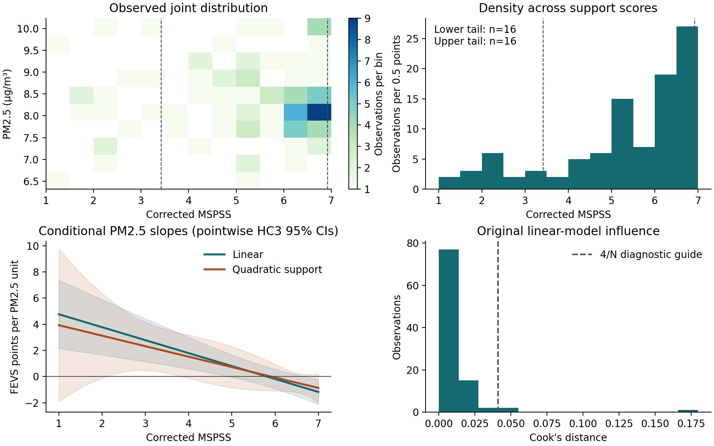

# Katie targeted follow-up: behavior

N=97 unchanged; no exclusions and no permutations. Aggregate-only output.

Support tails (inclusive 16th/84th-percentile anchors): n=16 at or below 3.42 and n=16 at or above 6.92.

At high support, the linear PM2.5 slope is -1.09 [-2.01, -0.17]; the fixed quadratic-support sensitivity gives -0.80 [-1.78, 0.18]. The negative point estimate survives the sensitivity and every single omission, but the quadratic interval includes zero. Distinguish attenuation from a reliably negative high-support association. HC3 intervals are pointwise; FEVS scoring remains provisional.

