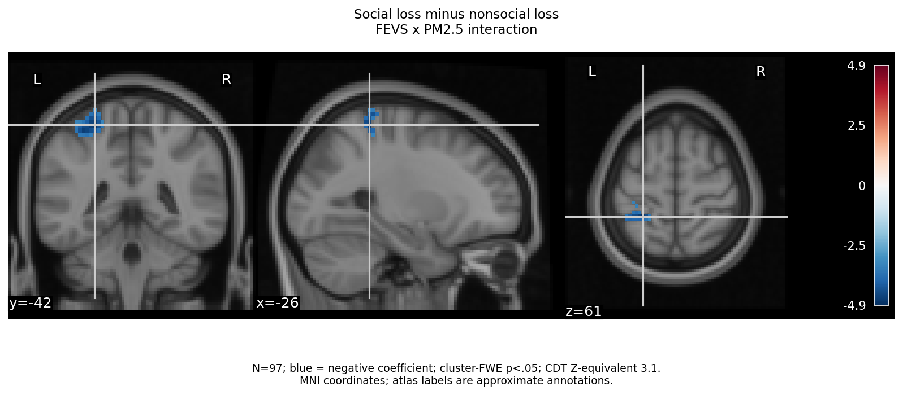
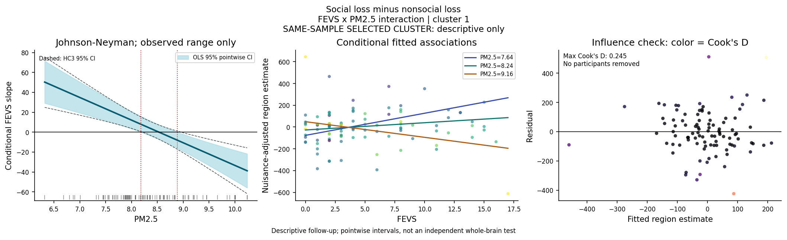
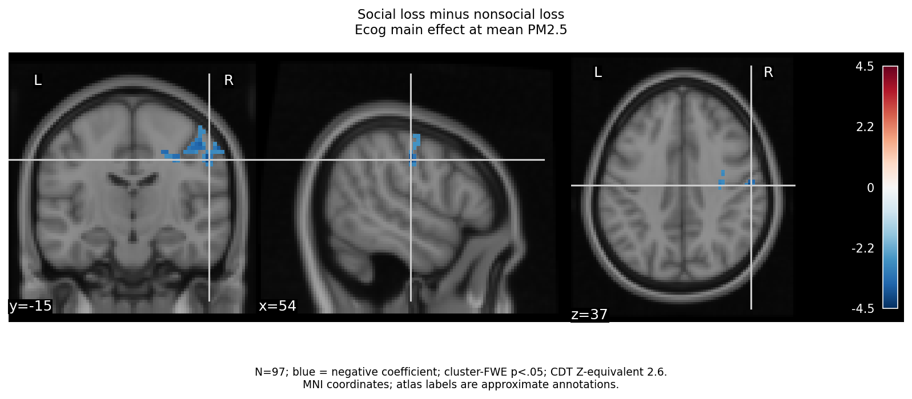
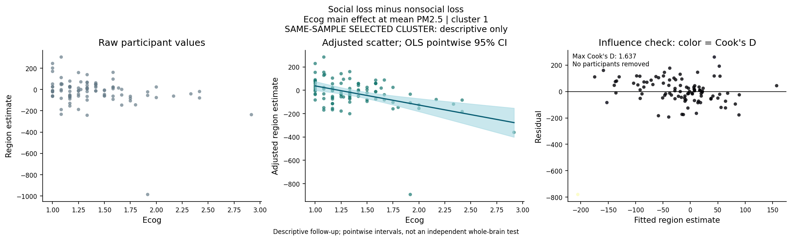
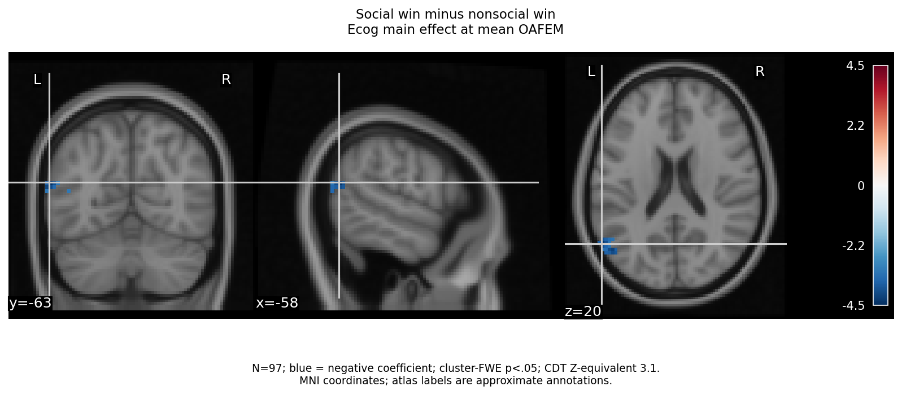
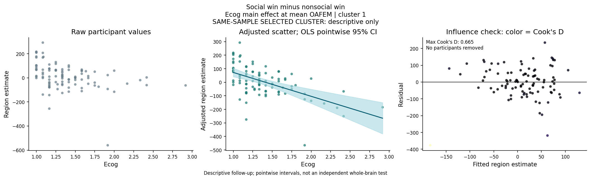

# FEVS Loss Moderation and Ecog Follow-Up

N=97; running inference, completed outputs and settled exclusions unchanged.
Three preidentified negative-direction activation findings only; not an exhaustive or final-batch report.
Loss = Social Doors loss minus Doors loss; win = Social Doors win minus Doors win. Neither is the win-minus-loss difference-of-differences.
The loss FEVS x PM2.5 plot tests an interaction; the Ecog plots show main effects at mean PM2.5 or mean OAFEM, NOT interactions.
Full original models retain both main terms and their interaction, age, gender, scanner era and signed FD/tSNR differences.
Blue brain overlays and signed peak t values indicate negative coefficients; the native negative-direction test has positive t in these voxels.
JN plots show conditional FEVS slopes across observed PM2.5 values only, OLS pointwise 95% intervals, HC3 sensitivity and observed-value rugs.
Selected-cluster estimates, JN regions and analytical intervals are descriptive, not independent confirmation. All 97 participants remain; influence flags do not create exclusions.
Cluster-FWE is per map, not across exploratory models, outcomes, directions or CDTs. These CDTs identify the reported findings, not a new optimization.
Anatomy uses validated local MNI background and optional Harvard-Oxford annotations; statistical images are never resampled.
Only aggregate PNGs/tables are published. Participant diagnostics and input fingerprints stay outside this report.

| Effect | Outcome | CDT Z | Voxels | Cluster-FWE p | Peak MNI | Atlas |
|---|---|---:|---:|---:|---|---|
| fevsxpm25 in fevsxpm25 | loss_only | 3.1 | 90 | 0.0495 | -26.2, -42.3, 61.7 | HarvardOxford-cort: Superior Parietal Lobule; HarvardOxford-sub: Left Cerebral Cortex |
| ecog in pm25xecog | loss_only | 2.6 | 290 | 0.0318 | 54.8, -15.3, 37.9 | HarvardOxford-cort: Postcentral Gyrus; HarvardOxford-sub: Right Cerebral Cortex |
| ecog in oafemxecog | win_only | 3.1 | 61 | 0.0453 | -58.6, -63.9, 20.1 | HarvardOxford-cort: Lateral Occipital Cortex, superior division; HarvardOxford-sub: Left Cerebral Cortex |

## FEVS x PM2.5 interaction | Social loss minus nonsocial loss

## fevs-pm25-loss-cluster-1 | JN, conditional slopes and influence

## Ecog main effect at mean PM2.5 | Social loss minus nonsocial loss

## ecog-pm25-loss-cluster-1 | raw/adjusted scatter and influence

## Ecog main effect at mean OAFEM | Social win minus nonsocial win

## ecog-oafem-win-cluster-1 | raw/adjusted scatter and influence

